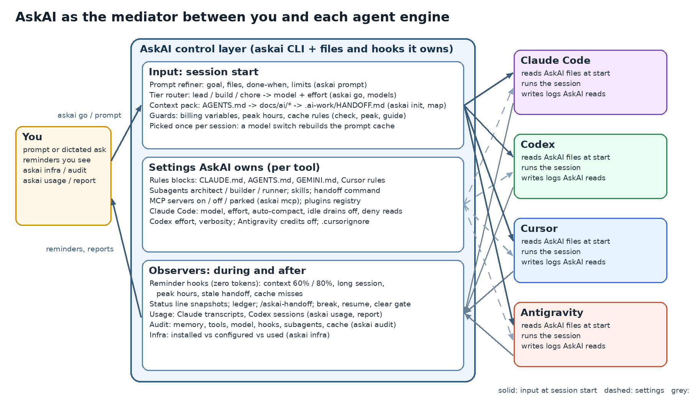
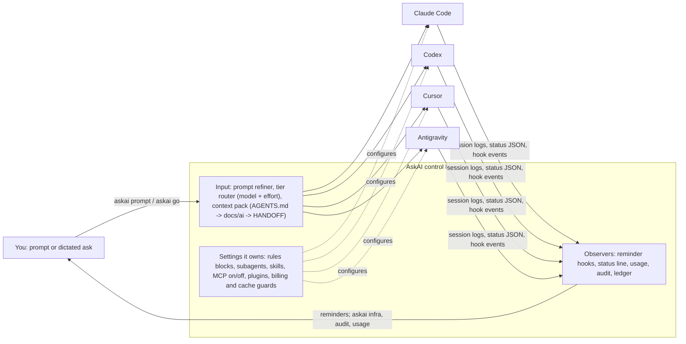
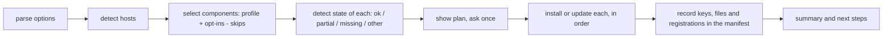

# AskAI 1.2.5 architecture

Generated by `node scripts/gen-docs.js` from the code; do not edit by hand. The tables of components, profiles, settings, commands and practices come straight from `lib/`, so this file always matches what AskAI does.

AskAI is a command-line tool that sets up Claude Code, Codex, Antigravity and Cursor for the longest possible usage, checks that they stay that way, and helps at breaks. Everything it does follows the evidence in `docs/research/`: settings and short rules that independent tests show save tokens, no compressors or proxies that tests show cost more.

## 0. AskAI as the mediator





| When | What passes through AskAI | How |
| --- | --- | --- |
| Before a session | The task, the tier (lead, build, chore), the model and effort, the active MCP servers, peak hours, the project context | `askai go`, `askai prompt`, `askai mcp`, `askai models`, `askai init` |
| During a session | The rules, subagents and skills AskAI wrote (the agent loads them); reminders at 60% and 80% context, long sessions, peak hours, stale handoff, cache misses | Files in each tool; Claude Code `SessionStart` and `UserPromptSubmit` hooks answering with `systemMessage` only (zero tokens) |
| At a break or a /clear | The handoff, the ledger, the check that the handoff is fresh | Ask the agent to write .ai-work/HANDOFF.md; `askai break`, `askai clear`, `askai resume` |
| After work | Usage, cache reuse, model switches, the models subagents really ran, what is installed versus used | `askai usage`, `askai audit`, `askai infra`, `askai session report` |

AskAI does not sit inside a running agent and rewrite each message: none of the four tools allows that without proxying their traffic, which can switch billing and breaks caching. It mediates at the boundaries (session start, breaks, clears) and inside the session through the files and hooks each tool already reads. That also matches the cache rule: the model, effort and tools are chosen once per session.

## 1. Design principles

- **Evidence first.** A tool or setting is installed by default only when official guidance or a third-party measurement supports it. Tools the benchmarks did not support stay opt-in (`--rtk`, `--context-mode`) or out.
- **Never override.** Every setting is added only when you have not set it; your own model, effort or rules stay. The retired AskAI defaults (haiku, effort medium, autoCompactWindow 150000) are the exception: the next baseline install updates them.
- **Reversible.** Each file is backed up before its first change; rule text lives in marked blocks; a manifest records every key, file and registration AskAI added, and `askai uninstall` removes only those.
- **No background work.** AskAI adds no hooks. Its own earlier hooks were measured to cost more than they saved.
- **No sudo, one install for four agents.** Package managers per OS (winget, Homebrew, vendor scripts, cargo), user-level paths only.

## 2. How AskAI saves tokens

| AskAI feature | Mechanism | Evidence |
| --- | --- | --- |
| Sonnet 5.5 default, Haiku subagents (when unset) | Everyday model at high effort; subagents mostly search | A model switch is the only repeated large saving across eight benchmarks |
| `effortLevel` high; Codex effort medium, verbosity low | High for the session; max only for the hard step | Thinking is billed as output (Anthropic) |
| Lean settings (suggestions, recaps, goal check-ins, cross-session wake-ups off) | No requests you did not ask for | Anthropic's cost guide lists each as a background request |
| `bashOutputMaxChars` and deny-read rules | Less tool output and no useless reads in context | Reads are about 90% of tool-result tokens |
| Token rules, build-lean rule, terse block in every host | Fewer turns, smaller diffs, shorter replies | Ponytail -10.3%, Caveman-style -8% |
| Path and glob rules | Detail loads only for matching files | Always-on instruction budgets (Anthropic, Antigravity) |
| `askai scaffold` (AGENTS.md, .cursorignore) | Agents stop re-discovering the project and skip junk files | Vendor guidance in all four tools |
| `askai check` | Catches drift: Opus default, high effort, API keys, oversized files, MCP sprawl | Each check maps to a rule above |
| `askai break` / `askai resume` | Nothing left running; fresh chat after the cache expires | Cache lifetime 1 h on a subscription, 5 min on usage credits |
| LSP plugins (`--lsp`) | Symbol navigation instead of whole-file reads | -13% cost (Marmelab) |
| `askai usage`, `askai report`, status line, ledger | You can see and compare what each tool and habit costs | Measure accepted work per token, not tool counters |

## 3. From installation to daily use

| Stage | Do | AskAI |
| --- | --- | --- |
| Day 0, each machine | Preview, install, open new sessions, confirm subscription billing | `askai install --dry-run`, `askai install`, `askai check` |
| Each repository | Shared instruction file, ignore list, local handoff folder | `askai scaffold .`, `askai check . --fix` |
| Start of a task | One task per chat; one complete prompt; plan for multi-file work | `askai start`, `askai tips peak` |
| While working | Search then read ranges, smallest change, Esc early, few cheap subagents | Rules installed in every host; `askai ask <topic>` |
| Before a break | Verified step, commit, handoff, stop background work | Ask the agent to write .ai-work/HANDOFF.md; `askai break` |
| Coming back | Continue within the cache lifetime; otherwise fresh chat from the handoff | `askai resume --copy` |
| Weekly | Compare tools and habits on accepted work per token | `askai usage 7`, `askai session report`, `/doctor` |
| Upgrades | Re-check after each tool update | `askai update`, `askai check` |

## 4. Module map

| File | Responsibility |
| --- | --- |
| `askai.js` | CLI: argument parsing, command dispatch, the install/update/uninstall pipeline, report |
| `install.ps1`, `install.sh` | Windows and macOS/Linux/WSL entry points: check Node, then run askai.js |
| `lib/components.js` | The Claude Code components and the ALL list (install order) |
| `lib/agents.js` | Codex, Antigravity, handoff, lean and code-intelligence components |
| `lib/cursor.js` | Host detection and the Cursor components |
| `lib/claude-config.js` | settings.json baseline, managed CLAUDE.md block, terse levels, token rules |
| `lib/profiles.js` | Profiles and component selection |
| `lib/rules.js` | Path-scoped rules for Claude Code and Cursor |
| `lib/pkg.js`, `lib/sys.js`, `lib/winpath.js` | Cross-platform installs, process helpers, Windows PATH |
| `lib/toml-lite.js` | Add-if-absent TOML editing for Codex |
| `lib/status.js` | status, doctor, status line, cache view |
| `lib/check.js` | askai check |
| `lib/kb.js` | The knowledge base behind askai ask |
| `lib/session.js` | Ledger, handoff, break, resume, measurements |
| `lib/usage.js` | Codex usage from session files |
| `lib/scaffold.js`, `lib/suggest.js`, `lib/tips.js`, `lib/help.js` | Repo files, profile suggestion, offline tips and peak hours, command help |
| `hooks/askai-report.js` | Transcript spend report (run on demand, not as a hook) |
| `standalone/` | The settings-only script for machines without AskAI |
| `scripts/` | Preview matrix, platform simulation, this generator |

## 5. Install pipeline



The diagram source renders on GitHub and in Mermaid-aware editors. A dry run stops after the plan. Each component has `detect`, `install`, `update` and `uninstall`; mirrors (for example `cursor-serena` for `serena`) follow the component they mirror.

## 5a. Project knowledge pack (askai init)

Long conversations are the biggest token cost: every turn re-sends the whole chat. `askai init` puts the context into small files, so `/clear` costs nothing and a new session reads only what the task needs.

| File | Purpose |
| --- | --- |
| `AGENTS.md` | Short index (under 333 lines): project, pointers, commands, working rules, sessions, delegation. Read by Codex, Cursor and Antigravity |
| `CLAUDE.md` | `@AGENTS.md` plus Claude-only notes. Shared rules stay in AGENTS.md |
| `GEMINI.md` | Antigravity-only notes. Gemini CLI loads this file; add AGENTS.md to `context.fileName` to load the router too |
| `docs/ai/PROJECT_MAP.md` | Folders, languages, commands, entry points. Purposes come from the README or a known folder name; a written purpose is kept |
| `docs/ai/SOURCE_INDEX.md` | Folder counts, then one row per eligible source file. Search it; do not load it whole |
| `docs/ai/REFERENCES.md` | Official pages for frameworks AskAI can check. Other dependencies are omitted. Page titles only; no repository text uploaded |
| `docs/ai/ARCHITECTURE.md` | Evidenced flow, static imports and README constraints. A decision row is added only after a decision is made |
| `docs/ai/FEATURES.md` | At most 12 rows: README bullets (documented) and routes or page modules (detected) |
| `docs/ai/WORK_ORDER.md` | The current task. An empty goal is replaced on the next init; a written goal is kept |
| `docs/ai/MODELS.md` | The tier table below. The task stays in the work order |
| `.claude/agents/`, `.codex/agents/`, `.cursor/agents/`, `.agents/agents/` | `architect`, `builder`, `runner` in each tool's format |
| `.claude/skills/`, `.agents/skills/` | `architecture-map`, `prompt-refiner`, `investigate-bug`, `verify-and-review` (load on demand) |
| `.cursorignore` | Dependencies, build output, secrets, and large media folders in the repo. An edited file is kept. Terminal and MCP tools can still read ignored paths |
| `.ai-work/` | Handoff, ledger and measurements (gitignored). The shipped handoff means no session is recorded |

Initialization also registers the canonical folder under a short name in `~/.askai/projects.json`. Tool integrations remain global; project files and `.ai-work/` stay in each repository. `lib/project-registry.js` resolves an explicit `--project NAME` or `-p NAME` first, then the terminal's `ASKAI_PROJECT`, the registered or initialized current directory, an optional default, and finally the older current-directory behavior. Missing registrations fail clearly. `lib/project-shell.js` supplies PowerShell, Bash and Zsh functions so `askai set project NAME` changes only the calling terminal. `docs/PROJECT_MANAGEMENT.md` covers registration, two terminals and moved folders.

Init scans eligible first-party source files locally (up to 1 MiB per file), records static declarations, routes and cross-folder imports, and fetches page titles from up to four fixed official framework documentation sites. It uses no model tokens and sends no repository contents. `--offline` skips the web lookup. Static evidence cannot establish runtime behavior, the current work order or handoff state; review those separately. Generated source detail is stored behind the short router and refreshed only when unedited.

The installed `askai-cli` entry point in each host runs `askai cli --prepare`. Prepare chooses the project from a named path, otherwise the chat's repository, otherwise the only registered project, and it asks only when several projects remain. It runs `askai init` when the pack is missing or source changed. The host agent then verifies the pack against code and official docs, asks for facts the repository cannot establish, and calls `askai review done`. That marker is gitignored in `.ai-work/` and compares source hashes on later calls. AI review uses model tokens; `askai init` in a terminal does not. `/askai-plugins` runs `askai plugins ready`: connected servers wait until the task matches, and the one-time step still left (a missing Graphify graph, an unregistered RTK hook) is done then. A new machine is checked with `askai setup <repo>`, which prints the hosts it found, the check counts, and whether the file validator passed. Status, infra, plugins, and the to-do list stay on their own commands.

## 5b. Model and effort per tier

| Tier | Agent | Use for | Claude Code | Codex | Cursor (Grok / Sonnet) | Antigravity |
| --- | --- | --- | --- | --- | --- | --- |
| lead | `architect` | Architecture and design, ambiguous debugging, security, cross-module integration | sonnet, high | gpt-6.1-sol, high | grok-4.7, xhigh / claude-sonnet-5, max | flash, high (model: flash in the file; /effort per session) |
| build | `builder` | Features, enhancements and bug fixes within the existing design | sonnet, high | gpt-6.1-sol, medium | grok-4.7, high / claude-sonnet-5, high | flash, high (model: flash in the file; /effort per session) |
| chore | `runner` | Cleanup, running scripts and tests, git, search, small docs edits | haiku, medium | gpt-6-luna, medium | grok-4.7, medium / claude-sonnet-5, medium | flash, high (model: flash in the file; /effort per session) |

Change one with `askai models set <tool>.<tier> <model>[:<effort>]`; `askai init --refresh` rewrites the agent files. Antigravity agent files accept only a tier (`flash`, `pro`, `flash_lite`, `inherit`); any other value makes Antigravity skip the file silently.

## 6. Components

In install order. Evidence labels: measured (a third-party saving), mixed, claims (vendor numbers only), none (a setting or prerequisite).

- **`token-kit`** · all hosts · in its profiles · evidence: none.
  Take over a previous run of the standalone token-setup script. only if ~/.token-kit/state.json exists: run standalone/token-setup.mjs --uninstall (removes its keys, rule blocks and handoff files, with backups), so AskAI applies the same settings once and the rules load once
- **`claude`** · Claude Code · in its profiles · evidence: none.
  Claude Code CLI. winget install Anthropic.ClaudeCode on Windows, brew install --cask claude-code on macOS, curl -fsSL https://claude.ai/install.sh | bash on Linux, only if the claude CLI is missing
- **`baseline`** · Claude Code · in its profiles · evidence: none.
  Settings baseline. settings.json: add (never override) model=claude-haiku-5-5 (Claude Code otherwise starts on Opus; --main-model), CLAUDE_CODE_SUBAGENT_MODEL=haiku, effortLevel=high, name-only skillOverrides; replace the retired haiku, medium, and autoCompactWindow 150000 defaults; remove leftover self-built askai hook registrations
- **`rtk`** · Claude Code · opt-in (--rtk) · evidence: reported.
  RTK (Bash output compression; opt-in, see README for the benchmarks). winget install rtk-ai.rtk on Windows, brew install rtk on macOS, cargo install --git https://github.com/rtk-ai/rtk (needs Rust from rustup.rs, or Homebrew) on Linux; check `rtk gain` works; winget install BurntSushi.ripgrep.MSVC on Windows, brew install ripgrep on macOS, manual: sudo apt-get install ripgrep  (or dnf install ripgrep) on Linux if rg is missing; `rtk init -g --auto-patch` (registers a PreToolUse hook on Bash)
- **`context-mode`** · Claude Code · opt-in (--context-mode) · evidence: reported.
  Context Mode (sandboxed tool output + session memory; opt-in). claude plugin marketplace add mksglu/context-mode; claude plugin install context-mode@context-mode (plugin hooks + ctx_* MCP tools; needs Node >= 22.5)
- **`serena`** · Claude Code · in its profiles · evidence: unmeasured.
  Serena (symbol-level code navigation). winget install astral-sh.uv on Windows, brew install uv on macOS, curl -fsSL https://astral.sh/uv/install.sh | sh; if that host is blocked, python3 -m pip install --user uv on Linux if missing; uv tool install -p 3.13 serena-agent (a stale uv python link is repaired if it blocks this); serena init; add its bin dir to the user PATH; claude mcp add --scope user serena (dashboard auto-open off)
- **`cursor-rtk`** · Cursor · in its profiles · evidence: reported · mirrors `rtk`.
  RTK for Cursor (shell output compression hook). winget install rtk-ai.rtk on Windows, brew install rtk on macOS, cargo install --git https://github.com/rtk-ai/rtk (needs Rust from rustup.rs, or Homebrew) on Linux if missing; rtk init -g --agent cursor --auto-patch (registers RTK's shell hook in ~/.cursor/hooks.json); backup first
- **`cursor-context-mode`** · Cursor · in its profiles · evidence: reported · mirrors `context-mode`.
  Context Mode for Cursor (MCP server). npm install -g context-mode@1.0.169 if missing (needs Node >= 22.5); add a "context-mode" entry to ~/.cursor/mcp.json (MCP tools only; Cursor does not run its hooks)
- **`cursor-serena`** · Cursor · in its profiles · evidence: unmeasured · mirrors `serena`.
  Serena for Cursor (MCP server). winget install astral-sh.uv on Windows, brew install uv on macOS, curl -fsSL https://astral.sh/uv/install.sh | sh; if that host is blocked, python3 -m pip install --user uv on Linux if missing; uv tool install -p 3.13 serena-agent; serena init; add a "serena" entry (--context ide, project from the working directory) to ~/.cursor/mcp.json
- **`markitdown`** · all hosts · opt-in (--markitdown) · evidence: unmeasured.
  markitdown (PDF and Office files to Markdown). winget install astral-sh.uv on Windows, brew install uv on macOS, curl -fsSL https://astral.sh/uv/install.sh | sh; if that host is blocked, python3 -m pip install --user uv on Linux if missing; uv tool install -p 3.13 markitdown[pdf,docx,pptx,xlsx,xls] (Microsoft, runs locally; converts a document to Markdown once so it is read as text); add its bin dir to the user PATH
- **`cursor-rules`** · Cursor · in its profiles · evidence: unmeasured · mirrors `rules`.
  Cursor user rules (~/.cursor/rules). writes ~/.cursor/rules/askai-*.mdc for the profile (always-applied token rules, plus glob-scoped code and document rules). Cursor loads these in every project on this machine. A file without the askai marker is left alone
- **`ccusage`** · Claude Code · opt-in (--ccusage) · evidence: none.
  ccusage (usage and cost report from local transcripts). npm install -g ccusage@20.0.24 (third-party; reads the local ~/.claude transcripts; it may fetch model prices over the network when it runs)
- **`caveman`** · Claude Code · in its profiles · evidence: unmeasured.
  Caveman terse style + token rules (CLAUDE.md block). CLAUDE.md: managed block with token rules (only for the tools present) and the terse-output directive (skipped if CLAUDE.md already has one); backup first
- **`caveman-plugin`** · Claude Code · opt-in (--caveman-plugin) · evidence: unmeasured.
  Caveman plugin (optional, adds its own hooks). claude plugin marketplace add JuliusBrussee/caveman; claude plugin install caveman@caveman (SessionStart + UserPromptSubmit hooks; may double the CLAUDE.md terse directive)
- **`rules`** · Claude Code · opt-in · evidence: unmeasured.
  Path-scoped rules (~/.claude/rules). writes ~/.claude/rules/askai-<kind>.md for the profile (coding and/or docs). Each rule has a paths: list, so Claude loads it only when it reads a matching file; backup first
- **`statusline`** · Claude Code · in its profiles · evidence: measured.
  Status line (measured savings). settings.json: statusLine -> `askai statusline` (RTK savings + Context Mode line); skipped if you already have a statusLine
- **`base-tools`** · all hosts · opt-in (--base-tools) · evidence: none.
  Base command-line tools (ripgrep, jq, gh). winget install BurntSushi.ripgrep.MSVC on Windows, brew install ripgrep on macOS, manual: sudo apt-get install ripgrep  (or dnf install ripgrep) on Linux, winget install jqlang.jq on Windows, brew install jq on macOS, manual: sudo apt-get install jq  (or dnf install jq) on Linux, winget install GitHub.cli on Windows, brew install gh on macOS, manual: sudo apt-get install -y gh  (or dnf install gh; https://cli.github.com) on Linux, each only if missing
- **`headroom`** · all hosts · opt-in (--headroom) · evidence: reported.
  Headroom (MCP mode: on-demand compression tools, no proxy). uv tool install --python 3.13 "headroom-ai[mcp]" if missing; register `headroom mcp serve` as an MCP server in Claude Code, Codex, Cursor and Antigravity (headroom_compress, headroom_retrieve, headroom_stats). Proxy mode is NOT set up: it can move Claude Code to API billing
- **`context7`** · all hosts · opt-in (--context7) · evidence: none.
  Context7 (current library docs over MCP). register `npx -y @upstash/context7-mcp` as an MCP server in Claude Code, Codex, Cursor and Antigravity (needs Node.js; the agent calls it only for library docs)
- **`graphify`** · all hosts · opt-in (--graphify) · evidence: claims.
  Graphify (code knowledge graph skill). uv tool install graphifyy if missing; `graphify install --platform claude|codex|cursor|antigravity` for each tool in play (its skill, a rule and, in Claude Code, a search hook). The Cursor rule is left off for ordinary turns. Build a project graph once with graphify update . (source only, no tokens). /graphify . also reads docs and images and spends tokens.
- **`repomix`** · all hosts · opt-in (--repomix) · evidence: none.
  Repomix (repository snapshot CLI, used on demand). npm install -g repomix if missing; nothing loads into sessions; use it for handovers between tools: repomix --compress --include "src/**"
- **`codebase-memory`** · all hosts · opt-in (--codebase-memory) · evidence: claims.
  codebase-memory-mcp (code knowledge-graph MCP server). npm install -g codebase-memory-mcp if missing; register it as an MCP server in Claude Code, Codex, Cursor and Antigravity; askai init indexes each repository with it (local, no model)
- **`claude-mem`** · Claude Code · opt-in (--claude-mem) · evidence: none.
  claude-mem (session memory plugin). claude plugin marketplace add thedotmack/claude-mem; claude plugin install claude-mem@thedotmack (hooks plus a background worker that summarises sessions with Claude, which uses your plan)
- **`prompt-hooks`** · Claude Code · in its profiles · evidence: none.
  In-session reminders (zero-token Claude Code hooks). settings.json hooks: SessionStart and UserPromptSubmit -> `askai hook` (one-line reminders shown only to you: context at 60% and 80%, long sessions, peak hours, stale handoff, cache misses; nothing is added to the model's context)
- **`codex-baseline`** · Codex · in its profiles · evidence: none · mirrors `baseline`.
  Codex config baseline (~/.codex/config.toml). config.toml: add (never override) model_reasoning_effort="medium", model_verbosity="low", personality="none", [agents] default_subagent_reasoning_effort="medium", [tui] auto_recap=false; --codex-model NAME also sets model; backup first
- **`codex-rules`** · Codex · in its profiles · evidence: unmeasured · mirrors `caveman`.
  Codex token rules + terse style (~/.codex/AGENTS.md block). AGENTS.md: managed block with the token rules and the terse directive (level as --caveman); backup first
- **`codex-rtk`** · Codex · in its profiles · evidence: reported · mirrors `rtk`.
  RTK for Codex (shell output compression hook). install rtk if missing; `rtk init -g --codex` (RTK's own PreToolUse hook + awareness note for Codex); backup first
- **`codex-serena`** · Codex · in its profiles · evidence: unmeasured · mirrors `serena`.
  Serena for Codex (MCP server, --context codex). install Serena with uv if missing; `codex mcp add serena -- serena start-mcp-server --context codex --project-from-cwd` (dashboard off)
- **`agy-baseline`** · Antigravity · in its profiles · evidence: none · mirrors `baseline`.
  Antigravity settings baseline (paid credits off). antigravity-cli/settings.json: add (never override) useG1Credits=false
- **`agy-rules`** · Antigravity · in its profiles · evidence: unmeasured · mirrors `caveman`.
  Antigravity token rules + terse style (~/.gemini/GEMINI.md block). GEMINI.md: managed block with the token rules and the terse directive (level as --caveman); backup first
- **`agy-rtk`** · Antigravity · in its profiles · evidence: reported · mirrors `rtk`.
  RTK for Antigravity (plugin hook). install rtk if missing; `rtk init --agent antigravity --auto-patch` (RTK's own plugin in ~/.gemini/config/plugins/rtk)
- **`agy-serena`** · Antigravity · in its profiles · evidence: unmeasured · mirrors `serena`.
  Serena for Antigravity (MCP server). install Serena with uv if missing; add a "serena" entry to ~/.gemini/config/mcp_config.json (kept if one exists); backup first
- **`agy-path-rules`** · Antigravity · in its profiles · evidence: unmeasured · mirrors `rules`.
  Antigravity path-scoped rules (~/.gemini/config/rules, glob-triggered). writes ~/.gemini/config/rules/askai-<kind>.md with `trigger: glob` frontmatter, so a rule loads only when a matching file is touched
- **`handoff`** · all hosts · in its profiles · evidence: none.
  Retired handoff launcher cleanup. remove only old AskAI-owned handoff launchers; use askai-cli for terminal commands
- **`lean`** · Claude Code · in its profiles · evidence: none.
  Lean Claude Code settings (idle drains off, Bash output cap, deny-read rules). settings.json: add (never override) promptSuggestionEnabled=false, awaySummaryEnabled=false, crossSessionInbound=hold, CLAUDE_CODE_GOAL_CHECKIN_MINUTES=0, bashOutputMaxChars=15000, deny Read() of node_modules/build/lockfiles/.env; --lean-git also includeGitInstructions=false
- **`code-intel`** · Claude Code · opt-in (--lsp) · evidence: none.
  Code intelligence (Claude Code's official LSP plugins). for each --lsp language: install its language server (npm for ts and py) and `claude plugin install <lang>-lsp@claude-plugins-official`

## 7. Profiles

| Profile | What it is | Components | Path rules |
| --- | --- | --- | --- |
| `minimal` | cheap model defaults, token and terse rules, status line; no MCP servers or plugins | token-kit, claude, baseline, caveman, statusline, rules, lean | none |
| `coding` | minimal + Serena (symbol-level navigation) + code rules | token-kit, claude, baseline, caveman, statusline, rules, lean, serena, ccusage | coding |
| `docs` | minimal + markitdown (PDF/Office to Markdown before reading) + document rules; no code navigation | token-kit, claude, baseline, caveman, statusline, rules, lean, markitdown, ccusage | docs |
| `full` | coding + markitdown + ccusage (third-party usage report), both rule sets | token-kit, claude, baseline, caveman, statusline, rules, lean, serena, markitdown, ccusage | coding, docs |
| `max` | everything: full + RTK, Context Mode, Headroom (MCP mode), Graphify, Context7, Repomix, Caveman plugin, LSP plugins (ts, py), base tools | token-kit, claude, baseline, caveman, statusline, rules, lean, serena, markitdown, ccusage, rtk, context-mode, caveman-plugin, headroom, graphify, context7, repomix, code-intel, base-tools | coding, docs |
| `lean` (default) | rules, terse mode, status line, baseline, tier defaults, base tools; no MCP servers | token-kit, claude, baseline, caveman, statusline, rules, lean, base-tools | none |
| `code` | same set as coding: Serena, code rules, ccusage | token-kit, claude, baseline, caveman, statusline, rules, lean, serena, ccusage | coding |
| `experimental` | same set as max; not recommended | token-kit, claude, baseline, caveman, statusline, rules, lean, serena, markitdown, ccusage, rtk, context-mode, caveman-plugin, headroom, graphify, context7, repomix, code-intel, base-tools | coding, docs |

## 8. Settings written

### Claude Code (`~/.claude/settings.json`)

| Key | Value | Component | Why |
| --- | --- | --- | --- |
| `model` | claude-haiku-5-5 | baseline | Claude Code starts on Opus otherwise; --main-model changes it |
| `effortLevel` | "high" | baseline | high for the session; max only for the hard step |
| `env.CLAUDE_CODE_SUBAGENT_MODEL` | "haiku" | baseline | subagents mostly search and read |
| `skillOverrides` | 20 bundled skills set to name-only | baseline | smaller skill listing in every session |
| `promptSuggestionEnabled` | false | lean | no extra request after each reply for the grey prompt prediction |
| `awaySummaryEnabled` | false | lean | no recap request when you come back to a session |
| `crossSessionInbound` | "hold" | lean | a message from another session does not wake this one with its whole context |
| `env.CLAUDE_CODE_GOAL_CHECKIN_MINUTES` | "0" | lean | no idle goal check-ins that re-send the full context |
| `bashOutputMaxChars` | 15000 | lean | Bash output read back into context is capped at 15k characters instead of 30k |
| `includeGitInstructions` | false | lean with --lean-git | no commit and PR instructions or git snapshot in every turn |
| `permissions.deny` | Read(./node_modules/**), Read(./dist/**), Read(./build/**), Read(./out/**), Read(./.next/**), Read(./coverage/**), Read(./target/**), Read(./vendor/**), Read(**/*.min.js), Read(**/*.map), Read(**/package-lock.json), Read(**/yarn.lock), Read(**/pnpm-lock.yaml), Read(**/.env), Read(**/.env.*) | lean | the most expensive useless reads, and secrets |

### Codex (`~/.codex/config.toml`)

| Key | Value | Why |
| --- | --- | --- |
| `model_reasoning_effort` | "medium" | less thinking by default |
| `model_verbosity` | "low" | shorter replies |
| `personality` | "none" | no personality section in the prompt |
| `[agents] default_subagent_reasoning_effort` | "medium" | cheaper subagents |
| `[tui] auto_recap` | false | no background recap requests |
| `model` | with `--codex-model` only | a cheaper default model |
| `[mcp_servers.serena]` | coding profile, when the codex CLI is missing | the same entry `codex mcp add` would write |

### Antigravity and Cursor

| Tool | File | What |
| --- | --- | --- |
| Antigravity | `~/.gemini/antigravity-cli/settings.json` | `useG1Credits: false` when unset |
| Antigravity | `~/.gemini/GEMINI.md` | the token rules block |
| Antigravity | `~/.gemini/config/rules/askai-*.md` | code and document rules with `trigger: glob` |
| Antigravity | `~/.gemini/config/mcp_config.json` | Serena (coding profile) |
| Antigravity | `~/.gemini/antigravity-cli/skills/askai-cli`, `~/.gemini/config/skills/askai-cli` | AskAI-only terminal |
| Cursor | `~/.cursor/rules/askai-*.mdc` | always-on token rule; code and document rules with globs |
| Cursor | `~/.cursor/mcp.json`, `~/.cursor/hooks.json` | Serena; RTK only with --rtk |
| Cursor | `~/.cursor/commands/askai-cli.md` | AskAI-only terminal |
| Claude Code, Cursor, Codex, Antigravity | `askai-plugins` command or skill | one-time plugin setup, then call each tool only when the task matches |

## 9. Files and data AskAI keeps

| Where | What |
| --- | --- |
| `~/.claude/askai/manifest.json` | every key, file and registration AskAI added (drives uninstall) |
| `~/.claude/askai/backups/` | a copy of each file before its first change (askai restore) |
| `~/.claude/askai/sessions/` | status-line snapshots of context and cache per session (askai report) |
| `~/.claude/askai/cache/` | cached tool checks for askai status |
| `<repo>/.ai-work/HANDOFF.md` | the current handoff, overwritten each time |
| `<repo>/.ai-work/SESSION_LEDGER.md` | append-only ledger of starts, breaks and finishes |
| `<repo>/.ai-work/measurements.csv` | one row per measured task |
| `<repo>/.ai-work/LAST_BREAK` | the time of the last askai break (askai resume) |

## 10. Commands

Where each command is implemented. Written from the `case` list in `askai.js` before behavior changes; `node scripts/gen-docs.js` fails if a command has no row.

| Command | Source |
| --- | --- |
| `askai cli` | `askai.js cmdCli; lib/cli-prepare.js` |
| `askai install` | `askai.js cmdInstall; lib/components.js; lib/profiles.js; lib/agents.js` |
| `askai update` | `askai.js cmdUpgrade` |
| `askai tools` | `askai.js cmdUpdate; lib/components.js` |
| `askai status` | `askai.js cmdStatus; lib/status.js; lib/findings.js` |
| `askai doctor` | `askai.js cmdDoctor; lib/status.js; lib/findings.js` |
| `askai report` | `askai.js cmdReport; lib/usage.js` |
| `askai profiles` | `askai.js cmdProfiles; lib/profiles.js` |
| `askai suggest` | `askai.js cmdSuggest; lib/suggest.js` |
| `askai project` | `askai.js cmdProject; lib/project.js; lib/project-registry.js; lib/project-refresh.js; lib/project-review.js; lib/daily.js` |
| `askai set` | `askai.js cmdSet; lib/project-registry.js` |
| `askai shell` | `askai.js cmdShell; lib/project-shell.js` |
| `askai uninstall` | `askai.js cmdUninstall; lib/components.js` |
| `askai restore` | `askai.js cmdRestore` |
| `askai statusline` | `askai.js cmdStatusline; lib/status.js` |
| `askai session` | `askai.js cmdSession; lib/session.js` |
| `askai init` | `askai.js; lib/project.js` |
| `askai review` | `lib/project-review.js` |
| `askai map` | `lib/project.js` |
| `askai models` | `askai.js cmdModels; lib/models.js` |
| `askai go` | `lib/launch.js` |
| `askai prompt` | `askai.js cmdPrompt; lib/prompt.js` |
| `askai mcp` | `askai.js cmdMcp; lib/mcp.js` |
| `askai audit` | `lib/audit.js; lib/findings.js` |
| `askai infra` | `lib/infra.js` |
| `askai inventory` | `lib/infra.js` |
| `askai guide` | `lib/guide.js` |
| `askai docs` | `askai.js cmdDocs` |
| `askai plugins` | `lib/plugins.js; lib/plugins-ready.js; lib/usage-guide.js` |
| `askai upgrade` | `askai.js cmdUpgrade` |
| `askai savings` | `lib/savings.js` |
| `askai convert` | `askai.js cmdConvert` |
| `askai clear` | `lib/guide.js` |
| `askai context` | `lib/guide.js` |
| `askai todo` | `lib/todo.js; lib/findings.js` |
| `askai diff` | `askai.js cmdDiff` |
| `askai graph` | `askai.js cmdGraph` |
| `askai hook` | `lib/hook.js` |
| `askai why` | `askai.js cmdWhy; lib/findings.js` |
| `askai next` | `askai.js; lib/daily.js` |
| `askai handoff` | `lib/daily.js` |
| `askai route` | `askai.js; lib/models.js` |
| `askai weigh` | `lib/daily.js` |
| `askai run` | `lib/daily.js` |
| `askai errors` | `lib/daily.js` |
| `askai snapshot` | `lib/daily.js` |
| `askai stop` | `lib/daily.js` |
| `askai bootstrap` | `lib/daily.js` |
| `askai check` | `askai.js cmdCheck; lib/check.js; lib/findings.js` |
| `askai test` | `askai.js cmdTest; lib/selftest.js` |
| `askai setup` | `askai.js cmdSetup; lib/setup.js` |
| `askai ask` | `askai.js cmdAsk; lib/kb.js; lib/knowledge.js` |
| `askai usage` | `askai.js cmdUsage; lib/usage.js; lib/savings.js` |
| `askai start` | `lib/session.js` |
| `askai break` | `lib/session.js` |
| `askai resume` | `lib/session.js` |
| `askai scaffold` | `askai.js cmdScaffold; lib/scaffold.js` |
| `askai chat` | `lib/chat.js` |
| `askai tips` | `lib/tips.js` |
| `askai version` | `askai.js` |
| `askai --version` | `askai.js` |

#### `askai cli`

```text
askai cli: Prepare a project from the chat folder, then open an AskAI-only terminal.

Usage: askai cli [--prepare] [--launch] [--path DIR] [--about TEXT]

askai cli --prepare finds the project (named path, the chat's repository, or the only registered project). A review exits 2 until --about supplies the one-or-two sentence description (dictation in the host chat is enough; AskAI cannot open a microphone). --yes does not bypass this question.
It then installs the max profile for the recorded target (every optimiser in that profile, skipping components already healthy) and records max so a later upgrade keeps it. It runs askai init when pack files are missing or source, README or build manifests changed, and prints JSON with action review or launch. A blocked download is not a failed review.
The host agent reviews the generated pack using that description, asks one bundled question for facts code still cannot establish, records askai review done, then askai cli --launch. On a devcontainer or SSH session there is no graphical terminal. --launch starts the CLI in tmux or screen, attaches this terminal when it can, and otherwise runs in the current terminal. askai upgrade and askai setup install tmux on that machine when they can do it without a password. The terminal runs commands locally without model tokens unless a command launches an AI agent. Terminal askai init still works with no AI session.

Examples:
  askai cli --prepare --json
  askai cli --prepare --path C:\work\shop --about "A shop for members" --json
  askai cli --launch
  askai> exit

Exit: 0, or 2 when the project or the description must be supplied
```

#### `askai install`

```text
askai install: Install and wire the token-saving setup for Claude Code, Codex, Antigravity and Cursor.

Usage: askai install [--profile P] [--target T] [--dry-run] [--yes] [options]

Detects each component, shows the plan, asks once, installs what is missing or partial, and records what it added in a manifest.
Sandbox homes: ASKAI_CLAUDE_HOME, ASKAI_CURSOR_HOME, ASKAI_CODEX_HOME, ASKAI_AGY_HOME. Extra tools: askai install --add ID.
Adds settings only when you have not set them; backs up every file before its first change; never prompts for a password. On a headless Linux machine, install, update and setup install tmux when the user is root or sudo -n works, so askai cli --launch can open a session. If astral.sh is blocked, uv is installed with python3 -m pip install --user uv.
If the standalone token-setup script was run on this machine, AskAI first runs its --uninstall (component token-kit) and then applies the same settings itself, so the rules load once.
Step-by-step instructions for each OS, the environment setup and every file it creates: docs/INSTALL.md.

Options:
  --profile minimal|coding|docs|full|max|lean|code|experimental tool set by kind of work (default lean; code = coding; experimental = max)
  --add ID,ID                              add components to the profile
  --list                                   print component ids and stop
  --host cursor|claude|codex|agy           limit one command to that host
  --brief                                  shorter status
  --quiet                                  skip the once-a-day hints
  --no-color                               plain text
  --target auto|claude|codex|agy|cursor|all|a,b hosts to wire (default auto: Claude Code plus every tool found)
  --seed-only                              write settings for a host that may not be installed yet (default target claude)
  --dry-run                                show the plan, change nothing
  --only ID,ID / --skip ID,ID              limit or exclude components
  --main-model M / --subagent-model M      Claude Code models when unset (default claude-haiku-5-5, subagent haiku; keep leaves the main model alone)
  --codex-model M                          Codex model when config.toml has none
  --caveman off|lite|full|ultra            terse-reply level (default full)
  --lsp ts,py,kotlin,ruby,swift            Claude Code's official code-intelligence plugins
  --lean-git                               also drop Claude's git instructions from every turn
  --base-tools                             also install ripgrep, jq and gh where missing
  --codebase-memory / --claude-mem         one flag each, not in max: another code-navigation server; a memory plugin that summarises sessions with your plan
  --force                                  re-run components already healthy

Writes: settings.json, CLAUDE.md, rules, commands, skills, config.toml, AGENTS.md, GEMINI.md, Cursor rules, MCP configs; the manifest and backups under ~/.claude/askai/

Examples:
  askai install --dry-run
  askai install --target all --profile max --project ~/code/app
  askai install --target all --profile full
  askai install --target claude,codex --lsp ts,py

Exit: 0 when every component is ok; 1 when one failed
```

#### `askai update`

```text
askai update: Update AskAI itself from GitHub and re-apply the recorded profile.

Usage: askai update

askai tools update upgrades the installed tools. askai upgrade still does this and prints a one-line hint at most once a day.

Examples:
  askai update

Exit: 0 or 1
```

#### `askai tools`

```text
askai tools: Upgrade the tools AskAI installed and refresh its rule blocks.

Usage: askai tools update [--target T]

Runs each component's update step (CLI upgrades, Serena, rule text) and keeps your own settings.

Examples:
  askai tools update

Exit: 0 or 1
```

#### `askai status`

```text
askai status: Per-tool state against your profile, with measured savings where a tool reports them.

Usage: askai status

Shows each component as ok, partial, missing or other, plus the evidence label (measured, mixed, claims only).

Examples:
  askai status

Exit: 0
```

#### `askai doctor`

```text
askai doctor: Alias of askai check. Same rows, same exit code.

Usage: askai doctor

Examples:
  askai doctor

Exit: 1 when a finding is severity now, else 0
```

#### `askai setup`

```text
askai setup: Short check after install: which hosts are present, check counts, and whether the file validator passed.

Usage: askai setup [dir] [--yes]

Does not reprint status, infra, plugins, or the to-do list. Those stay on askai status, askai infra, askai plugins ready, and askai todo.
A finding that needs a fix now is listed, up to three. The file validator prints only its failures.
Sign-in, restart, and model checks stay in the to-do list.
--yes runs install, then init. --yes --dry-run prints those two commands and changes nothing.

Examples:
  askai setup
  askai setup ~/code/shop
  askai setup --yes

Exit: 1 when a finding needs a fix now or the file validator fails, else 0
```

#### `askai check`

```text
askai check: Audit this machine and a repository against the token-saving guidelines.

Usage: askai check [dir] [--fix] [--json] [--env]

Machine: billing variables, default and subagent models, effort, idle drains, CLAUDE.md size, MCP counts, RTK and Context Mode, Codex keys and AGENTS.md size, Antigravity paid credits and GEMINI.md size, Cursor rules, peak hours.
Repo: AGENTS.md and CLAUDE.md (present, size, import), .cursorignore, .ai-work/ gitignored, age of the last handoff.
Each gap is printed with the command that fixes it.
askai check --env prints the platform block only: OS, shell, Node, TTY, git, package manager, container, HOME, clipboard.
askai setup prints the counts. This command prints each row.

Options:
  --fix                                    scaffold the repo and create .ai-work (never overwrites)
  --json                                   machine-readable rows
  --env                                    platform block only

Examples:
  askai check
  askai check . --fix
  askai check --env

Exit: 1 when a finding is severity now (bills outside your plan), else 0
```

#### `askai why`

```text
askai why: The message and fix for one finding from askai check.

Usage: askai why <finding-id>

An unknown id is one line.

Examples:
  askai why repo.agents-missing

Exit: 1 when the id is unknown, else 0
```

#### `askai next`

```text
askai next: The top actions from askai check: at most 3 to do now and 2 for later.

Usage: askai next [dir]

Examples:
  askai next

Exit: 0
```

#### `askai handoff`

```text
askai handoff: Write .ai-work/HANDOFF.md from git facts. Judgment fields stay as TODO(you).

Usage: askai handoff [dir] [--for claude|codex|cursor|agy] [--fill]

--for prints a short resume prompt for that host. --fill prints a prompt that asks the agent to complete only the TODO lines.

Examples:
  askai handoff
  askai handoff --for codex

Exit: 0
```

#### `askai weigh`

```text
askai weigh: Offline token estimate (chars/4), labeled estimate. Flags a file over the threshold.

Usage: askai weigh <path> [--threshold N]

Examples:
  askai weigh docs/ai/SOURCE_INDEX.md

Exit: 1 when the path cannot be read, else 0
```

#### `askai run`

```text
askai run: Run a command, keep the full log in .ai-work/last.log, and print the exit code plus the last lines.

Usage: askai run -- <command>

A command that looks like flash, reboot, or copy_dut waits for --yes.

Examples:
  askai run -- npm test

Exit: the command exit code, or 1 when a risky command has no --yes
```

#### `askai errors`

```text
askai errors: Print error lines from a log, with two lines of context, de-duplicated.

Usage: askai errors [log]

Examples:
  askai errors .ai-work/last.log

Exit: 0
```

#### `askai snapshot`

```text
askai snapshot: Write a git diff patch and an untracked-file list under .ai-work/snapshots. Does not stash or commit.

Usage: askai snapshot [dir] [--include-untracked]

--include-untracked copies untracked work files under 1 MB, skipping tool directories.

Examples:
  askai snapshot

Exit: 0
```

#### `askai route`

```text
askai route: Pick a tier from the task words and print the cheaper-first escalation rule. Does not launch an agent.

Usage: askai route "task"

Examples:
  askai route "rename the helper"

Exit: 0
```

#### `askai stop`

```text
askai stop: List running agent CLIs. --yes terminates them.

Usage: askai stop [--yes]

Examples:
  askai stop

Exit: 0
```

#### `askai bootstrap`

```text
askai bootstrap: Write .devcontainer/askai-postcreate.sh so a rebuild runs askai install and project refresh.

Usage: askai bootstrap [dir] [--profile P]

Examples:
  askai bootstrap

Exit: 0
```

#### `askai ask`

```text
askai ask: Offline answers on etiquette and the research: the rule, why, the command in each tool, and what AskAI automates.

Usage: askai ask <words>

Keyword search over the built-in knowledge base; no model call, no network.

Examples:
  askai ask compact
  askai ask coming back after a break
  askai ask is rtk worth it
  askai ask superclaude

Exit: 0 when something matches, 1 otherwise
```

#### `askai start`

```text
askai start: Start a task: ledger entry with tool, task, branch and last commit.

Usage: askai start --tool T --task "..." [--repo DIR]

Examples:
  askai start --tool claude --task "Fix mobile nav"

Exit: 0
```

#### `askai break`

```text
askai break: Before a break: checklist, running agent CLIs, handoff reminder, a ledger entry and the break time.

Usage: askai break [--summary "..."] [--next "..."] [--repo DIR] [--dry-run]

Examples:
  askai break --summary "menu closes, tests green" --next "check 320px"

Exit: 0
```

#### `askai resume`

```text
askai resume: Coming back: time away, continue-or-fresh advice from the cache lifetime, the handoff, git state, the resume prompt.

Usage: askai resume [--copy] [--repo DIR]

Options:
  --copy                                   copy the prompt with pbcopy, clip, wl-copy, xclip or xsel

Examples:
  askai resume --copy

Exit: 0
```

#### `askai usage`

```text
askai usage: What Claude Code and Codex spent, from their local data; where to look for Antigravity and Cursor.

Usage: askai usage [days] [--cache] [--plugins] [--full] [--week]

Claude Code: ccusage when installed, else the transcript spend report. Codex: ~/.codex/sessions, read best effort.
When neither has sessions, one reason is printed. No zero tables.
--cache prints cache hit per session from status-line snapshots for that window. One line when there are none.
--plugins prints one savings line for each installed plugin. One line when none are installed. A missing plugin is omitted.
--full prints the session summary, then the cache section, then the plugin lines.
--week is the 7-day summary plus the top three findings.

Examples:
  askai usage 7
  askai usage --cache
  askai usage --plugins
  askai usage --full
  askai usage --week

Exit: 0
```

#### `askai report`

```text
askai report: Alias of askai usage --full plus one line from askai check --brief.

Usage: askai report [days]

Examples:
  askai report

Exit: 0
```

#### `askai session`

```text
askai session: The per-repo ledger in .ai-work/: entries, handoff, measurements, report. askai start, askai break and askai resume are the daily names for those three actions.

Usage: askai session init|pause|status|finish|measure|report [--repo DIR] [...]

measure: --tool --model --effort --task --difficulty --minutes --input-tokens --output-tokens --cached-tokens --success 0|1 --rework-minutes --usage-source --notes
report [dirs...]: accepted tasks and tokens per tool and difficulty.
session pause records a task boundary without the break checklist. session start, session break and session resume still run the same actions as the short commands.

Examples:
  askai session measure --tool codex --difficulty simple --minutes 12 --input-tokens 8000 --output-tokens 1500 --success 1
  askai session report ~/code/app1 ~/code/app2

Exit: 0
```

#### `askai scaffold`

```text
askai scaffold: Write the files every agent reads: AGENTS.md, CLAUDE.md, docs/ai/PROJECT_PROFILE.md, .cursorignore, .ai-work/. Never overwrites.

Usage: askai scaffold [dir] [--dry-run]

Examples:
  askai scaffold ~/code/myapp

Exit: 0
```

#### `askai suggest`

```text
askai suggest: Recommend a profile from the files in a folder.

Usage: askai suggest [dir]

Examples:
  askai suggest .

Exit: 0
```

#### `askai profiles`

```text
askai profiles: What each profile installs.

Usage: askai profiles

Examples:
  askai profiles

Exit: 0
```

#### `askai project`

```text
askai project: Manage registered projects, or copy Cursor rules into a repository for teammates.

Usage: askai project [dir] [--print|--remove] | list | show | rename OLD NEW | path NAME NEW_PATH | remove NAME | switch [NAME] | refresh [dir] | hide-local [dir] [--personal|--shared|--undo]

list prints every registered name and path. show reports the selected project. rename, path and remove change only the registry; remove never deletes project files.
refresh creates only missing init files, then rewrites the project map and prints the review state. At most 8 lines. A current review skips the map rewrite. It also hides local AI paths.
hide-local adds AskAI paths to the local git exclude list. --personal is that default. --shared prints the team checklist and writes nothing. --undo removes that block.
Without a subcommand, the existing Cursor rules behavior is preserved.

Examples:
  askai project list
  askai project show
  askai project rename old new
  askai project path app C:\code\app
  askai project .
  askai project refresh .
  askai project hide-local
  askai project hide-local --shared

Exit: 0
```

#### `askai set`

```text
askai set: Select a project for this terminal or set a persistent fallback.

Usage: askai set project NAME | project --clear | default NAME | default --clear

Project selection stays in askai cli, or in a shell after enabling askai shell init. The persistent default is used when no project is active or detected from the current directory.

Examples:
  askai set project digimanova
  askai set project --clear
  askai set default digimanova

Exit: 0, or 1 for an unknown project
```

#### `askai shell`

```text
askai shell: Enable terminal-scoped project selection in a shell.

Usage: askai shell init powershell|bash|zsh | install SHELL --path PROFILE | uninstall

Install adds one managed block to a shell profile; uninstall removes only blocks AskAI installed. The installers offer this with -ShellIntegration or --shell-integration.

Examples:
  Invoke-Expression (& askai shell init powershell)
  eval "$(askai shell init bash)"

Exit: 0
```

#### `askai tips`

```text
askai tips: The cheat sheet, offline, per tool. peak says whether Claude is in peak hours now.

Usage: askai tips [claude|codex|agy|cursor|session|habits|peak]

Examples:
  askai tips codex
  askai tips peak

Exit: 0
```

#### `askai test`

```text
askai test: Run the safe commands one by one, print a short status, and write one capture file.

Usage: askai test [--out FILE] [--json] [--real] [--notty] [--compare FILE]

Default: sandbox homes and a throwaway fixture repo. The status says which commands finished and which are over their line budget.
askai test --real runs read-only commands against the real homes and this repo. It does not write.
--json writes one object per command: cmd, exit, ms, lines, maxWidth, flags.

Options:
  --out FILE                               capture path (default .ai-work/askai-test.txt in the current folder)
  --json                                   write {cmd, exit, ms, lines, maxWidth, flags} per command
  --real                                   read-only commands against the real homes; no writes
  --notty                                  rerun a short subset with stdin closed
  --compare FILE                           print line and time regressions against a previous --json file

Examples:
  askai test
  askai test --out askai-test.txt
  askai test --real
  askai test --json --compare previous.json

Exit: 0 when every command finished, 1 when one did not run
```

#### `askai statusline`

```text
askai statusline: Claude Code's status line command (reads the session JSON on stdin): model, context, cache; records snapshots for askai report.

Usage: askai statusline [--demo]

On a terminal with no JSON, it prints how to try it. Claude Code pipes the session JSON; that path still prints one status line.

Exit: 0
```

#### `askai restore`

```text
askai restore: List backups, or put a backed-up file back.

Usage: askai restore [file]

Examples:
  askai restore
  askai restore ~/.claude/settings.json

Exit: 0 or 1
```

#### `askai uninstall`

```text
askai uninstall: Remove only what AskAI added: keys still holding AskAI's value, its marked blocks, its own files and registrations.

Usage: askai uninstall [--only ID,ID] [--dry-run]

Examples:
  askai uninstall --dry-run
  askai uninstall --only rtk

Exit: 0 or 1
```

#### `askai version`

```text
askai version: Print the AskAI version.

Usage: askai version

Exit: 0
```

#### `askai init`

```text
askai init: Scan eligible first-party source files, consult detected frameworks' official docs, write a compact project knowledge pack and register its path.

Usage: askai init [dir] [--name NAME] [--path DIR] [--about "..."] [--type T] [--yes] [--refresh] [--offline] [--dry-run] [--build "cmd"] [--test "cmd"]

Reads README, manifests and every eligible first-party source file up to 1 MiB each. Excludes dependencies, build output and private files. Static imports, declarations and routes are evidence, not runtime proof. Fetches page titles from up to four fixed official documentation sites; no repository text is uploaded and no model is called. Network failures are marked in REFERENCES.md.
  AGENTS.md (short router), CLAUDE.md, GEMINI.md
  docs/ai/PROJECT_MAP.md, SOURCE_INDEX.md, ARCHITECTURE.md, FEATURES.md, REFERENCES.md, WORK_ORDER.md, MODELS.md
  architect, builder and runner agents for all four tools; four skills; .cursorignore; .ai-work/ (gitignored)
Current task and session handoff cannot be inferred from source. Existing user text is preserved. --refresh updates generated files only when unedited.
askai project refresh runs init for missing files, then the map and the review.

Options:
  --name NAME / --path DIR                 register a short name and project folder
  --project NAME / -p NAME                 use a registered project
  --about TEXT / --type T                  override detection
  --build "cmd" / --test "cmd"             override detected checks
  --offline                                skip official-doc lookup (cached results remain available)
  --yes                                    no questions; use what was detected
  --refresh                                update AskAI blocks and unedited generated files
  --dry-run                                show the plan without network or writes

Examples:
  askai init .
  askai init --name shop --path ~/code/shop --yes
  askai init --project shop --refresh --yes

Exit: 0
```

#### `askai review`

```text
askai review: Show which project inputs changed since host AI review; record completion after review.

Usage: askai review [status|done] [--project NAME] [--json] [--all]

askai-cli checks status before its AI review. It calls done only after the agent has checked and enriched the project pack. Status compares local hashes of source, README and build manifests; JSON lists changed and removed paths. The default path list is capped at 40; --all returns every path. The marker lives in the project's gitignored .ai-work folder; it never proves behavior or replaces tests.

Examples:
  askai review status --project shop --json
  askai review status --project shop --all --json
  askai review done --project shop

Exit: 0
```

#### `askai map`

```text
askai map: Regenerate docs/ai/PROJECT_MAP.md from README folder descriptions and conventional names; preserve purposes you edited.

Usage: askai map [dir] [--dry-run] [--diff]

Examples:
  askai map
  askai map --dry-run --diff

Exit: 0
```

#### `askai models`

```text
askai models: Model and effort per task tier (lead, build, chore) for each tool; used by askai go and the agent files.

Usage: askai models [set <tool>.<tier> <model>[:<effort>] | verify [tool]]

Defaults: Claude Code sonnet/high, sonnet/high, haiku/medium; Codex gpt-6.1-sol/high, gpt-6.1-sol/medium, gpt-6-luna/medium (there is no gpt-6.1-luna); Cursor grok-4.7 xhigh/high/medium (Sonnet tiers with cursor.useSonnet true); Antigravity flash, effort high.
Antigravity agent files accept only a tier (flash, pro, flash_lite, inherit). verify lists the IDs your Cursor and Antigravity accounts offer. Lead effort max is opt-in: askai go --effort is not a flag; set the tier with askai models set.

Examples:
  askai models
  askai models set codex.chore gpt-6-luna:high
  askai models set cursor.useSonnet true
  askai models verify cursor

Exit: 0
```

#### `askai go`

```text
askai go: Start a session with the tier's model and effort fixed for the whole session, a structured first prompt, and a ledger entry.

Usage: askai go <claude|codex|cursor|agy|task> [--tier lead|build|chore] ["task"] [--files a,b] [--done "..."] [--resume] [--dry-run]

A task with no host name uses Claude Code and a tier chosen from the words. Cheaper first: chore, then build, then lead.
Claude Code: --model and CLAUDE_CODE_EFFORT_LEVEL; Codex: -m and model_reasoning_effort; Cursor: --model (effort is part of the ID); Antigravity: prints /model and /effort to type first.
Shows peak hours and active MCP servers first: switch MCP servers before a session, not during it.
When the agent exits, AskAI writes a snapshot and a handoff draft. A container, CI job, or piped command has no keyboard. askai go then prints the command and returns, instead of waiting on the agent. Run it in the Cursor terminal.

Examples:
  askai go claude --tier build "fix the cart total rounding in src/cart.ts"
  askai go "rename the helper"
  askai go codex --tier chore "clean up unused imports"
  askai go agy --resume

Exit: the agent's exit code, or 0 when there is no terminal to hand over
```

#### `askai prompt`

```text
askai prompt: Turn a rough or dictated ask into a structured prompt: goal, files, done-when, constraints, output limit, tier.

Usage: askai prompt "ask" [--tier T] [--kind bug|feature|design|risky|commit|firmware] [--files a,b] [--done "..."] [--mode blunt,brutal,assume,counter,contrast] [--copy] | --output-safe "cmd" | --resume

Removes dictation fillers, finds file names, picks a tier from the words (file names do not count). --output-safe asks the agent to plan a noisy command before running it. --resume prints the fresh-session prompt from the handoff.

Options:
  --output diff|brief|full                 diff: only the diff and one line per check; brief (default); full: with reasoning
  --kind bug|feature|design|risky|commit|firmware the pattern for that kind of task

Examples:
  askai prompt "um so fix the login bug in src/auth.ts"
  askai prompt --output-safe "npm run build"
  askai prompt --resume --copy

Exit: 0
```

#### `askai mcp`

```text
askai mcp: Every MCP server in the four tools, and a switch: Antigravity's disabled flag, Codex's enabled key, parking for Claude Code and Cursor.

Usage: askai mcp [list | on <name> | off <name>] [--tool claude|codex|cursor|agy] [--dry-run]

Parking moves the entry into ~/.claude/askai/mcp-parked.json after a backup; on puts it back. Switch between sessions: the tool list is part of the cached prompt.

Examples:
  askai mcp
  askai mcp off playwright
  askai mcp on serena --tool codex

Exit: 0, or 1 for an unknown server
```

#### `askai audit`

```text
askai audit: The seven-point token audit: memory files, tools and proxies, model and effort, hooks, subagents, scheduled work, cache reuse.

Usage: askai audit [dir] [--json]

Reads the newest Claude Code session log: cache read share, model switches, compactions, and the model each subagent really used. Codex: cached share and models used.

Examples:
  askai audit
  askai audit --json

Exit: 1 when a high-severity finding exists
```

#### `askai infra`

```text
askai infra: Tools and repository files. Alias of askai inventory.

Usage: askai infra [dir] [--json]

Examples:
  askai infra
  askai infra ~/code/shop --json

Exit: 0
```

#### `askai inventory`

```text
askai inventory: Tools and repository files. Alias of askai infra.

Usage: askai inventory [dir] [--json]

Examples:
  askai inventory

Exit: 0
```

#### `askai guide`

```text
askai guide: The etiquette for each moment of work, offline.

Usage: askai guide [install|start|work|break|resume|clear|compact|cache|models|subagents|mcp|output|prompts|docs|plugins|peak|all]

Examples:
  askai guide resume
  askai guide cache

Exit: 0
```

#### `askai docs`

```text
askai docs: Find AskAI documents or check generated command documentation for drift.

Usage: askai docs [install|architecture|projects|guide|cheatsheet|changelog|preview|check] [--print]

Examples:
  askai docs
  askai docs projects --print
  askai docs check

Exit: 0 when current; 1 when generated docs differ
```

#### `askai plugins`

```text
askai plugins: Every token tool researched: evidence, what runs on its own versus by command, installed or not. ready says which connected tools wait for a matching task, and the one-time steps still left.

Usage: askai plugins [list | ready [dir] | info <id> | install <id> | decisions]

Options:
  ready [dir]                              Serena, Context7, Headroom, Context Mode, Graphify and RTK: connected or not, when the agent should call each, and any one-time step left
  info <id>                                what it is, the evidence, its commands in a terminal and inside the agent, how to check it works, where to see its savings, how to switch it off
  install <id>                             verified installs for Context7, Repomix and Graphify
  decisions                                every tool AskAI evaluated, where it stands and why

Examples:
  askai plugins
  askai plugins ready
  askai plugins info headroom
  askai plugins install context7 --dry-run

Exit: 0
```

#### `askai convert`

```text
askai convert: Convert a PDF, Office file, web page or YouTube URL to Markdown with Microsoft MarkItDown, locally; never overwrites.

Usage: askai convert <file|url> [--out file.md] | askai convert scan [dir] [--yes] [--ignore-originals]

scan lists PDF and Office files and an offline token estimate. --yes converts when markitdown is installed and caches under .ai-work/converted/. --ignore-originals writes the originals into .cursorignore.

Examples:
  askai convert spec.pdf
  askai convert scan
  askai convert scan --yes --ignore-originals

Exit: 0, or 1 when MarkItDown is missing
```

#### `askai clear`

```text
askai clear: Gate before /clear or /compact: is the handoff fresh (under 30 minutes)? Prints the native command; AskAI cannot type into a running agent.

Usage: askai clear [compact] [--tool claude|codex|cursor|agy] [--repo DIR]

Examples:
  askai clear
  askai clear compact --tool codex

Exit: 0 when safe, 1 when a handoff is needed first
```

#### `askai context`

```text
askai context: What to do at this context level: continue, hand off, clear. 60% is a warning, not an order to compact.

Usage: askai context <percent> | --used N --window M

Examples:
  askai context 63
  askai context --used 124000 --window 200000

Exit: 0
```

#### `askai upgrade`

```text
askai upgrade: Fetch the latest AskAI from GitHub (git, into ~/.claude/askai/src) and run its install with the profile and target recorded last time.

Usage: askai upgrade [--dry-run] [--agents] [install options]

Always the latest: the default branch of https://github.com/aalokshah-business/AskAi. Options after upgrade go to the install (for example --profile max).
ASKAI_REPO (owner/name) or ASKAI_REPO_URL (a full git URL or path) point at a fork or a test copy.
Without git, run the one-line installer from the README again: it downloads the latest archive instead.
askai update is different: it upgrades the tools AskAI installed (Serena, ccusage, plugins).
--agents then opens Claude Code and Cursor for separate source-backed reviews and Codex for verified improvements, in sequence on the updated checkout. All three CLIs must be on PATH. Exit each session to continue; on Windows paste the copied task. This spends model tokens; a plain upgrade does not.

Options:
  --dry-run                                show what it would fetch and run
  --agents                                 after install, review with Claude Code, Cursor and Codex, then apply verified changes

Examples:
  askai upgrade
  askai upgrade --profile max
  askai upgrade --agents

Exit: 0, or 1 when install or the agent workflow fails
```

#### `askai savings`

```text
askai savings: Alias of askai usage --plugins.

Usage: askai savings

Examples:
  askai savings

Exit: 0
```

#### `askai todo`

```text
askai todo: Remaining setup and project-review steps: sign-ins, restarts, app settings, model IDs, one-time plugin steps, and repository facts that need confirmation. Checkable items clear themselves.

Usage: askai todo [dir] [--all] | askai todo done <id> | askai todo undo <id>

Exit: 0
```

#### `askai diff`

```text
askai diff: git diff --stat, staged changes and the whitespace check, so you review a change before handing off; the agent gets only the files it needs.

Usage: askai diff [dir] [--review]

--review prints a short prompt that names only the changed files.

Exit: 1 when the whitespace check finds problems
```

#### `askai graph`

```text
askai graph: Print the Mermaid architecture diagram from docs/ai/ARCHITECTURE.md and open it in the browser when the terminal is interactive.

Usage: askai graph [dir]

Writes .ai-work/architecture.html and opens it. The page loads Mermaid from the network. A piped or non-interactive run only writes the file.

Exit: 0, or 1 when there is none yet
```

#### `askai chat`

```text
askai chat: Where to paste a short standing instruction in Claude chat, ChatGPT, and Gemini, and how the four coding apps are set up instead.

Usage: askai chat [claude|chatgpt|gemini|code] [--copy]

Claude chat (claude.ai and the Claude desktop app), ChatGPT web and desktop, and Gemini Apps have no settings file AskAI can write. The instruction is sent again on every turn, so it stays short.
claude.ai and the Claude desktop app share Instructions for Claude. ChatGPT web and desktop share Custom instructions. Gemini Apps uses Instructions for Gemini. A project instruction replaces or adds to that only inside the project.
Claude Code, Cursor, Codex, and Antigravity are not configured by this paste. askai install writes their rules. AskAI cannot read the chat apps' usage counters or move a plan reset.

Examples:
  askai chat
  askai chat claude
  askai chat chatgpt

Exit: 0, or 1 for an unknown name
```

#### `askai help`

```text
askai help: Command names in alphabetical order, one command in detail, or every command in full.

Usage: askai help [command|all]

Examples:
  askai help
  askai help check
  askai help all

Exit: 0
```

## 11. Inside the agents

| Tool | Command or skill | What it does |
| --- | --- | --- |
| Claude Code | `/askai-cli` | opens the AskAI-only terminal |
| Codex | `$askai-cli` | opens the AskAI-only terminal |
| Antigravity | `/askai-cli` | opens the AskAI-only terminal |
| Cursor | `/askai-cli` | opens the AskAI-only terminal |
| Claude Code | `/askai-plugins` | one-time plugin setup; call each tool only when the task matches |
| Codex | `$askai-plugins` | one-time plugin setup; call each tool only when the task matches |
| Antigravity | `/askai-plugins` | one-time plugin setup; call each tool only when the task matches |
| Cursor | `/askai-plugins` | one-time plugin setup; call each tool only when the task matches |

## 12. Practices AskAI knows (askai ask)

- **Fresh chat for each task** (`askai ask clear`): One task per chat; clear between unrelated tasks. Clearing is free.
  Why: Every turn re-sends the whole conversation; calls over 150K context were 75% of one heavy week (dotclaude).
- **Compacting is not free** (`askai ask compact`): Compact only a chat you must keep, at a natural boundary, with instructions; prefer a handoff plus a fresh chat.
  Why: /compact reads the whole conversation to write its summary: a large request itself (Anthropic cost guide).
  AskAI: askai break, then a fresh chat
- **One complete prompt** (`askai ask one-prompt`): Send one prompt with the goal, the files and how to verify; do not drip-feed follow-ups.
  Why: Each extra message is another full re-read of the context (dotclaude; AI LABS; your screenshot page 1).
- **Edit instead of correcting** (`askai ask edit-regenerate`): If an answer is slightly wrong, edit your message and regenerate rather than sending a correction.
  Why: Follow-ups stay in history and are re-sent every turn (your screenshot page 1).
- **Point at files** (`askai ask files`): Name the file and function with @path; avoid "improve the codebase".
  Why: Vague prompts trigger broad scanning (Anthropic); @ targeting minimises token overhead (Antigravity docs).
- **Plan before multi-file edits** (`askai ask plan`): Use plan mode for anything touching more than two files and approve before edits.
  Why: A wrong path costs the work twice (Anthropic, Antigravity, Cursor docs; screenshot page 2).
- **Give a verification target** (`askai ask verify`): Give a test, command or expected output that proves the task is done.
  Why: Agents that can check their own work need fewer correction rounds (Anthropic, Antigravity best practices).
- **One round of questions** (`askai ask questions`): Ask for one round of clarifying questions, then proceed.
  Why: Open-ended question loops add turns; your screenshot page 2 rule kept to one round.
- **Stop wrong turns early** (`askai ask stop-early`): Press Esc as soon as the agent drifts, then rewind instead of arguing.
  Why: All four vendors document it; every extra wrong step is re-read later.
- **Paste only what matters** (`askai ask paste`): Paste the failing function or the last 10-40 log lines, not the whole log.
  Why: Your screenshot page 5; Anthropic filters test output to failures in its hook example.
- **Search, then read ranges** (`askai ask reads`): Search first, then read only the needed line ranges; batch independent reads in one message.
  Why: Reads were 90.6% of tool-result tokens in one workload (Marmelab); parallel calls cost one turn (dotclaude).
  AskAI: askai install writes this rule for every host
- **Smallest change that works** (`askai ask smallest`): Ask for the smallest change that solves the task; no speculative features or unrequested refactors.
  Why: Ponytail measured -10.3% cost, quality unchanged (JetBrains, p=0.004).
  AskAI: askai install writes the build-lean rule for every host
- **Terse replies** (`askai ask terse`): Ask for terse answers: no preamble or narration; exact code and errors.
  Why: Caveman-style rules: median -8% cost over six studies, quality unchanged.
  AskAI: askai install writes the terse block (--caveman lite|full|ultra|off)
- **Few, cheap subagents** (`askai ask subagents`): Use subagents only for broad searches or logs, on a cheap model; no agent teams for routine work.
  Why: Teams use about 7x tokens (Anthropic); each fresh subagent writes ~14K tokens before its first call (dotclaude).
  AskAI: askai install sets the subagent model
- **Short instruction files** (`askai ask instruction-files`): Keep CLAUDE.md / AGENTS.md / GEMINI.md under 200 lines, as an index; move workflows into skills.
  Why: They load every session and every subagent (Anthropic); Codex caps at 32 KiB; Antigravity always-on rules share 20K tokens.
  AskAI: askai check measures them
- **Unused MCP servers off** (`askai ask mcp`): Disable MCP servers you do not use today; prefer CLIs like gh, rg and jq.
  Why: Each server adds tool names and instructions to every session (Anthropic cost guide).
  AskAI: askai check counts servers
- **Convert documents first** (`askai ask documents`): Convert PDFs, Office files and HTML to Markdown before attaching.
  Why: Binary documents cost far more tokens than their text.
  AskAI: askai install --profile docs installs markitdown
- **Claude Code models** (`askai ask model-claude`): Haiku for search and small edits, Sonnet for everyday work, Opus (or Sonnet + /advisor opus) only for the hard step.
  Why: A model switch is the only repeated large saving in the benchmarks; Claude Code defaults to Opus since 22 Sep 2026.
  AskAI: askai install sets a cheap default when none is set
- **Codex models** (`askai ask model-codex`): A Luna-class model for routine work, Sol for hard tasks; start fresh before 272K input tokens.
  Why: Published Plus estimates: Luna 350-3,000 messages per 5 h, Sol 15-160; inputs past 272K bill input at 2x.
  AskAI: askai install --codex-model NAME
- **Antigravity models** (`askai ask model-agy`): Flash for routine work; Pro or Claude for hard tasks; quota is per model, so switch when one runs out.
  Why: Antigravity plans page; Flash has its own pool that refreshes more often.
- **Cursor models and Auto** (`askai ask model-cursor`): Auto for routine work; a frontier model only for the hard task; Max Mode off.
  Why: Cursor pricing: Auto bills $1.25/M input, $6/M output, $0.25/M cache reads, cheaper than frontier models but not free.
- **High effort for Claude, medium elsewhere** (`askai ask effort`): Claude Code defaults to high effort. Use max only for the hard step. Codex and Antigravity stay on medium.
  Why: Thinking is billed as output (Anthropic); one creator measured max effort at 3.5-4x tokens.
  AskAI: askai install sets high effort for Claude Code and medium for Codex
- **Advisor instead of Opus** (`askai ask advisor`): For a hard task, keep a Sonnet session and run /advisor opus instead of switching to Opus.
  Why: The advisor is consulted at decision points; analyses put it about a third cheaper than Opus throughout.
- **No speed or big-context modes** (`askai ask speed-modes`): Leave Claude fast mode, Codex Fast/Ultrafast, Cursor Max Mode and Antigravity /boost off unless speed matters more.
  Why: They spend allowance faster: fast mode bills credits at 2x; Codex Fast 2.5x, Ultrafast 8x.
- **Avoid Claude peak hours for big jobs** (`askai ask peak`): Run big refactors and long agent runs outside weekdays 08:00-14:00 US Eastern.
  Why: Anthropic, March 2026: the 5-hour window drains faster at peak (your screenshot page 9).
  AskAI: askai tips peak
- **Before a break** (`askai ask break`): Finish the verified step, commit or stash, ask the agent to write .ai-work/HANDOFF.md, stop loops, goals and background agents.
  Why: Background work keeps spending; the cache expires after 1 h (5 min on usage credits).
  AskAI: askai break
- **Coming back** (`askai ask resume`): Within the cache lifetime and with a small context, continue; otherwise start fresh from the handoff.
  Why: The first message after the cache expires re-processes the whole conversation (Anthropic).
  AskAI: askai resume (prints the prompt; --copy copies it)
- **When you hit a limit** (`askai ask limit`): Wait for the reset, switch model family after a model-specific limit, or switch to a model with its own pool.
  Why: Claude: /model sonnet after an Opus limit; Codex: /usage shows resets; Antigravity: Flash pool; Cursor: Auto.
- **Billing traps** (`askai ask billing`): Unset ANTHROPIC_API_KEY, ANTHROPIC_BASE_URL and OPENAI_API_KEY unless you mean to pay per token; keep Antigravity credits off.
  Why: An API key overrides your plan; Headroom-style proxies showed "API Usage Billing" (your screenshot page 18).
  AskAI: askai check and askai doctor flag them
- **RTK** (`askai ask rtk`): Not recommended by default: measure on your own work if you try it.
  Why: Median +7% task cost over six third-party studies; its counter logged 96M tokens saved in runs that cost 7.6% more.
  AskAI: askai install --rtk (opt-in)
- **Context Mode** (`askai ask context-mode`): Not recommended by default.
  Why: The one paired study measured +33% to +72% cost.
  AskAI: askai install --context-mode (opt-in)
- **Headroom** (`askai ask headroom`): Installed with --headroom or the max profile in MCP mode: the agent calls headroom_compress on large outputs. Proxy mode (headroom wrap, ANTHROPIC_BASE_URL) is not set up by AskAI.
  Why: Vendor reports 47-92% on large tool outputs; four independent studies found a median +32% cost; proxy mode moved Claude Code to API billing in your screenshot.
  AskAI: askai install --headroom; askai infra shows where it is registered
- **Proxies and routers** (`askai ask proxies`): Avoid on a subscription.
  Why: Proxies can switch billing, break the prompt cache and send code to third parties.
- **Code navigation plugins** (`askai ask lsp`): Install the official code-intelligence plugin for typed languages.
  Why: LSP navigation measured -13% cost (Marmelab); Anthropic recommends it.
  AskAI: askai install --lsp ts,py
- **Usage jumps while idle** (`askai ask desync`): Compare /stats in the CLI with claude.ai's usage bar; report a mismatch.
  Why: Reported counter-desync bug (GitHub issues #38335, #39507).
- **Keep junk out of Cursor** (`askai ask cursor-ignore`): Add .cursorignore for node_modules, build output, lockfiles, .env and large data.
  Why: Cursor indexes and reads what it can see; ignored files cost nothing.
  AskAI: askai scaffold writes it; askai check looks for it
- **Codex: local before cloud** (`askai ask codex-local`): Run small jobs locally; ask for several cloud attempts only when you will compare them.
  Why: OpenAI says cloud tasks can use more of the allowance; each attempt is its own run.
- **Nest AGENTS.md by folder** (`askai ask nested-agents`): Put a service's rules in its own folder's AGENTS.md so they load only there.
  Why: Codex reads AGENTS.md from the repo root down to the current folder (OpenAI).
- **SuperClaude** (`askai ask superclaude`): Optional: its --uc mode is a terse-output rule like Caveman; the framework itself loads several thousand tokens of instructions every session.
  Why: Claims 30-50% fewer tokens with --uc; no third-party measurement found; one analysis lists ~1.6K tokens of commands and ~2.3K of flags loaded by its CLAUDE.md imports.
  AskAI: askai installs a short terse block instead
- **Doctor and audit tools** (`askai ask doctor-tools`): Run the built-in /doctor weekly; askai check covers tokens and billing for all four tools; LLM-based config audits cost tokens each run.
  Why: Built-in /doctor flags large CLAUDE.md files, agent descriptions over 15K tokens and MCP tools over 25K. claude-config-doctor is an LLM skill (costs tokens); claude-doctor analyses transcripts offline and writes rules.
  AskAI: askai check, askai doctor
- **Status lines and monitors** (`askai ask statusline`): Keep one status line showing context and cache; monitors show where tokens go but save nothing by themselves.
  Why: ccstatusline, CCometixLine, claude-powerline, claude-hud and Token Monitor (26+ tools including Codex, Cursor and Antigravity) are measurement tools.
  AskAI: askai installs its own status line
- **Budget guards** (`askai ask budget`): A budget guard can warn before the weekly cap; it does not reduce tokens per task.
  Why: tokenlens reads Claude Code session logs (exact usage) and can allow, warn, ask or deny tool calls against your weekly cap.
- **Offloading reads to subagents** (`askai ask offload`): Moving reads into a subagent shrinks the main context, not the bill: the subagent's tokens are still spent.
  Why: TokenRoll's scout claims 83% less main context; each fresh subagent writes ~14K tokens before its first call (dotclaude). Worth it only for very large reads.
- **All-in-one token plugins** (`askai ask plugin-bundles`): Prefer settings and short rules; bundles that inject rules through SessionStart hooks add text to every session.
  Why: context_guard (14 skills, hooks) and token-saver (rules, cheap subagents, audit) publish no third-party measurement; their sound parts match what askai already sets.
- **Long chats are the biggest cost** (`askai ask long-chat`): Keep sessions to one task; let project files carry the context so /clear costs nothing.
  Why: Every turn re-sends the whole conversation; turns over 150K tokens were 75% of one measured heavy week (dotclaude).
  AskAI: askai init writes the project files; askai clear checks the handoff first
- **Project files instead of chat history** (`askai ask project-files`): Keep a small router (AGENTS.md) pointing to PROJECT_MAP, ARCHITECTURE, FEATURES, WORK_ORDER and the handoff; after /clear the agent reads only what the task needs.
  Why: A cleared session that reads a 40-line handoff and two files costs far less than a long chat re-sent every turn.
  AskAI: askai init, askai map
- **What breaks the prompt cache** (`askai ask cache-breakers`): Choose the model and MCP servers before the session and keep them; compact rarely.
  Why: A model switch, connecting or disconnecting an MCP server, a plugin that adds MCP tools, compaction and fast mode rebuild the cache; an effort change keeps it (Anthropic). Legacy env names still seen in the wild, not recommended: ENABLE_PROMPT_CACHING_1H, FORCE_PROMPT_CACHING_5M.
  AskAI: askai go, askai audit (shows switches and cache share)
- **Limit tool output** (`askai ask tool-output`): Cap, grep or summarise output before it reaches the chat: quiet flags, tail -n 40, only failing lines.
  Why: Bash output above the cap is never read; AskAI sets bashOutputMaxChars to 15,000. Hooks that rewrite commands measured no net saving (RTK).
  AskAI: askai prompt --output-safe "cmd"
- **Prompt modifiers** (`askai ask modes`): Add one modifier line instead of a long instruction: BLUNT, BRUTAL, ASSUME, COUNTER, CONTRAST.
  Why: One line replaces several turns of back-and-forth when you want a direct critique.
  AskAI: askai prompt --mode brutal
- **Graphify** (`askai ask graphify`): Optional for very large repos: build the graph once and point the agent at GRAPH_REPORT.md.
  Why: Claims 71.5x fewer tokens per query; an independent test saw ~0% when the agent ignored the graph; building it costs tokens; its Claude hook fires on every search.
  AskAI: askai plugins install graphify; askai map links the report
- **Graftcode rules** (`askai ask graftcode`): In a project that uses Graftcode, add its rules so agents call methods through generated packages instead of writing REST code.
  Why: Graftcode publishes a small CLAUDE.md router plus per-language rules read on demand (grft-dev/graftcode-demos).
  AskAI: askai plugins info graftcode
- **Memory plugins** (`askai ask memory-tools`): Use at most one memory tool; the handoff file and project files are usually enough.
  Why: No independent measurement for claude-mem or Supermemory; both add context to sessions.
  AskAI: askai plugins info claude-mem
- **Context7 and Repomix** (`askai ask docs-tools`): Context7 for current library docs when needed; Repomix only for handovers between tools, narrowed to the folders that matter.
  Why: A full repository snapshot is large; symbol search reads less.
  AskAI: askai plugins install context7 | repomix
- **Aider** (`askai ask aider`): A separate coding agent, not a plugin: run it in its own session and never on the same files as another agent.
  Why: Its /architect mode separates planning from editing, like AskAI's lead and build tiers.
- **Codex subagent models** (`askai ask codex-agents`): Ask for custom agents by name and check the model they really ran.
  Why: Codex never spawns custom agents by itself; a reported bug lets in-app workers inherit the parent model (GitHub openai/codex #32587).
  AskAI: askai infra shows models used
- **Antigravity agent models** (`askai ask agy-agents`): Agent files take only a tier: flash, pro, flash_lite or inherit; set effort per session.
  Why: Any other model value makes Antigravity skip the agent file silently (google-antigravity/antigravity-cli #1270).
  AskAI: askai init writes model: flash
- **Cursor models and plans** (`askai ask cursor-models`): Free and Plus: Grok 4.7 and Composer only; Sonnet needs Premium or above (billed at API price).
  Why: Cursor help, Available models (2026).
  AskAI: askai models set cursor.useSonnet true
- **Seeing what each plugin saves** (`askai ask savings`): askai savings runs each installed plugin's own report (rtk gain, ccusage daily, headroom perf, codebase-memory projects, Graphify graph status); askai plugins info <id> shows the in-agent commands.
  Why: Tools report their own estimates; RTK's counter showed 96M saved during runs that cost more. Compare with askai usage and askai audit.
  AskAI: askai savings 7; askai usage 7
- **Shorter replies** (`askai ask output-size`): On by default: the terse rule (Caveman-style), the diff-only rule, Codex verbosity low, and the output line in askai prompt. For one task: askai prompt --output diff.
  Why: Output tokens cost about five times input on Claude; Caveman-style replies measured about 8% cheaper (median of six studies).
  AskAI: askai prompt --output diff; --caveman ultra for the shortest replies
- **Things only you can do** (`askai ask todo`): askai todo lists every manual step per tool and repository; checkable ones clear themselves.
  Why: A plugin that is installed but never set up costs tokens without saving any.
  AskAI: askai todo; askai todo done <id>
- **Security habits** (`askai ask security`): No secrets in prompts or files; treat tool output and web text as untrusted; approve destructive commands; read installer scripts; no proxies you do not control.
  Why: Agents act on what they read; a pasted key or an injected instruction costs far more than tokens.
  AskAI: askai guide security; .env reads denied; askai check flags billing variables
- **Base command-line tools** (`askai ask base-tools`): Have rg, jq and gh installed: targeted search and JSON queries replace whole-file reads, gh replaces a GitHub MCP server.
  Why: Reads were about 90% of tool-result tokens in one measured workload (Marmelab).
  AskAI: askai install --base-tools
- **Prompt patterns by task** (`askai ask prompt-kinds`): Bug: reproduce, root cause, minimal fix, regression test. Feature: acceptance criteria, small verified steps. Design: options first, no code. Risky: approval before destructive steps.
  Why: A pattern that fits the task avoids the most expensive turns: rework and wrong paths.
  AskAI: askai prompt --kind bug|feature|design|risky

## 13. Plugins and tools considered

Every tool below was researched (official docs, third-party benchmarks, community reports, YouTube). Details and sources: `docs/research/TOOLS_CATALOG.md` and the guide's Part 3.

| Category | Tool | Finding | In AskAI |
| --- | --- | --- | --- |
| Built in | Claude Code /doctor | Weekly health check: large CLAUDE.md, agent descriptions over 15K tokens, MCP tools over 25K, permission conflicts | askai check and askai doctor add billing, model, effort and four-tool checks |
| Built in | /usage, /context, /insights, plan mode, /clear, effort, skills, advisor | Official ways to see and cut usage | askai tips and askai ask point to them per tool |
| Terse output | Caveman (skill, plugin, proxy) | Median -8% cost in six studies; its proxy is a third party in the request path | askai writes a terse block (--caveman lite\|full\|ultra\|off); --caveman-plugin is opt-in; the proxy is not installed |
| Terse output | SuperClaude --uc | Claims 30-50%; no third-party measurement; the framework loads several thousand tokens of instructions | Not installed; askai ask superclaude |
| Smallest change | Ponytail, Karpathy guidelines, claude-token-efficient | Ponytail -10.3% (JetBrains); claude-token-efficient -11.6% (THOL) | askai writes the build-lean rule |
| Compression proxy | Headroom | Median +32% in four studies; can move Claude Code to API billing | Not installed; askai check fails on ANTHROPIC_BASE_URL |
| Compression proxy | lean-ctx, pxpipe, llmtrim, ClaudeSlim | lean-ctx +10.3%; others unmeasured; pxpipe lossy | Not installed |
| Shell output filter | RTK | Median +7% cost; its own counter overstated savings | Opt-in --rtk; askai check warns when wired |
| Context sandbox | Context Mode | +33% to +72% in the one paired study | Opt-in --context-mode; askai check warns when on |
| Code navigation | Claude Code LSP plugins | -13% cost (Marmelab) | Opt-in --lsp ts,py,kotlin,ruby,swift |
| Code navigation | Serena | No third-party measurement | coding and full profiles, all four hosts |
| Code navigation | CodeGraph, code-review-graph, Graphify, Claude Context, Token Savior and others | Small or no measured effect | Not installed |
| Audit | claude-config-doctor (LLM skill), claude-doctor (offline transcript analysis) | Useful reviews; the LLM one spends tokens per run | askai check is deterministic and free |
| Plugin bundles | context_guard, token-saver, TokenRoll scout | No third-party measurement; scout moves reads to subagents (still billed) | Their sound parts are askai settings and rules |
| Budget guard | tokenlens | Warns or blocks against your weekly cap; saves nothing per task | askai usage and the status line show spend |
| Measurement | ccusage, Claude-Code-Usage-Monitor, ccstatusline, CCometixLine, claude-powerline, claude-hud | Show where tokens go | ccusage in the full profile; askai status line |
| Measurement | Token Monitor (26+ tools), Claude/Codex quota bar for VS Code and Cursor, Antigravity Cockpit, Cursor dashboard | Cross-tool views | Named by askai usage |
| Routers | 9Router, OmniRoute, claude-code-router, routatic-proxy, Weave Router | Billing, terms and data risk on a subscription | Not installed |
| Memory | claude-mem, ICM, Greplica, Magic Compact, Dynamic Context Pruning | No independent measurement | Not installed; the handoff file replaces them |
| MCP trimming | mcp2cli, Token Optimizer MCP | Only matters with many MCP servers | askai check counts servers |
| Rules on demand | CARL / BASE | Keyword-loaded rules | askai uses path and glob rules |
| Documents | markitdown | PDF and Office to Markdown before reading | docs and full profiles |
| Hosted or paid | Edgee, Fermat, Parsec, WOZCODE | Single-study results | Not installed |
| Bundles | tokless, dotclaude | Wire several of the above; dotclaude publishes measured usage | askai follows dotclaude's evidence, not its tools |
| Docs retrieval | Context7 | Current library documentation over MCP; no saving measured | askai plugins install context7 |
| Snapshots | Repomix | Whole-repo snapshot; large; useful for handovers between tools | askai plugins install repomix; narrow with --include |
| Separate agent | Aider | Its own sessions and /architect mode; never on the same files as another agent | askai plugins info aider |
| Memory | Supermemory | Hosted memory MCP; no independent measurement | Off; the handoff file replaces it |
| Rules | Graftcode rules | CLAUDE.md router plus per-language rules read on demand, for Graftcode projects | askai plugins info graftcode |
| Code indexes | SigMap, codebase-memory-mcp, Graft (Nanonets) | No independent measurement; Graft's structural layer needs no API key | Optional for very large repos |
| Prompt compression | LLMLingua | Library for your own API apps | Not wired into the four CLIs |
| API routing | LiteLLM, OpenRouter | Per-token API billing; a subscription does not transfer | Not for subscription use |
| Toolkits | ChatGPT-built AskAI toolkit (Python) | Policies, a work order, a clear/compact gate, manual context readings | Merged into AskAI: work order, router, orchestration rules, skills, clear gate, context advice |

## 14. Safety and uninstall

- Backups before the first change to each file; `askai restore` lists and restores them.
- Marked blocks in CLAUDE.md, AGENTS.md and GEMINI.md; text outside them is never touched.
- `askai uninstall` removes keys only while they still hold AskAI's value, its blocks, its own files and its MCP and plugin registrations.
- `askai check` fails when `ANTHROPIC_API_KEY` or `ANTHROPIC_BASE_URL` is set or Antigravity's paid credits are on; `askai doctor` adds broken-config checks.

## 15. Testing and previews

- `node --test test/*.test.js`: every component installs, detects and uninstalls in throwaway folders; settings are never overridden; the CLI, checks, knowledge base, break and resume, usage and this document are tested.
- `bash scripts/preview-matrix.sh`: `askai install --dry-run` on simulated Linux, macOS and Windows for each tool and all four, plus the standalone script; results in `docs/PREVIEW_MATRIX.md`.
- `node scripts/gen-docs.js --check`: this file matches the code.

## 16. Standalone script

`standalone/token-setup.mjs` applies the same settings without AskAI (no CLI, ledger or checks), for machines where you want only the configuration. See `standalone/README.md`.

The two never run side by side: `askai install` applies every setting token-setup applies (a test compares them), and running both would load the token rules twice. When token-setup ran first, the `token-kit` component runs its `--uninstall` and AskAI applies the same settings under its own manifest. When AskAI is installed, token-setup stops and points to `askai check` (`--force` overrides).

## 17. Adding a component

1. Add an object with `id`, `host`, `title`, `evidence`, `plan`, `detect`, `install`, `update` and `uninstall` to `lib/components.js` or `lib/agents.js`; record what it adds in the manifest.
2. Add it to a profile in `lib/profiles.js`, or mark it `optIn` with an `optInFlag`.
3. Add a test in `test/` for install, detect and uninstall in a throwaway folder.
4. Run `node scripts/gen-docs.js` to refresh this file.
