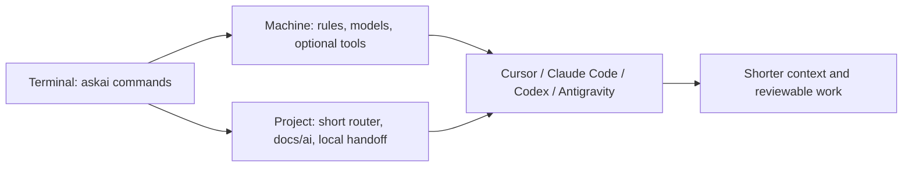
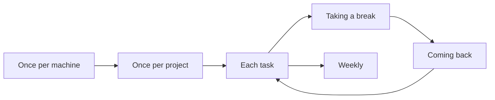

# AskAI cheat sheet

Twelve commands cover a working day. `askai` with no command is `askai next`. Everything else is `askai help more` or `askai help all`.

## Start here: the one-time sequence

Once per machine: install AskAI (`get.sh` or `get.ps1`, see the install guide), `askai install --retry` to finish anything left, then `askai check --all`, `askai infra` and `askai status` to verify. Once per project: `askai init` in the folder (no model, no tokens), reload the Cursor window or start a new Claude Code session, then `/askai-cli --review` (Codex: `$askai-cli --review`; the agent reviews the generated files and fills the gaps, and this is the one step that uses tokens) and `/askai-plugins`; `askai todo` lists the few steps only you can do. Prefer a window: `/askai-gui`. Keep it current with `askai update`, then exit and reopen `askai cli` (or the Ask AI window).

## How AskAI fits together

Run AskAI in a terminal for local checks and file generation. Opening an AskAI skill or slash command in an AI chat uses model tokens. `askai go` launches an AI tool; that session uses the tool's model allowance.

AskAI stores local session state under `.ai-work/` and excludes it through `.git/info/exclude`. Project guidance remains in the repository. Cursor must open the initialized project as its workspace root to find `.cursor/commands/askai-cli.md`.

## The loop

| Phase | Sequence |
|---|---|
| Once per machine | `askai install` then `askai check --fix` then `askai infra`. Retry only failed items with `askai install --retry` |
| Once per project | `askai init` or `askai project refresh`, then `askai project hide-local`, then `askai check` |
| Each task | `askai next`, `askai prompt`, `askai go <tool> "task"`, `askai run -- <command>`, `askai errors`, then `askai diff` |
| Taking a break | `askai break`, complete the draft with `askai handoff "next step"`, then `askai clear` when it says safe |
| Coming back | `askai resume --copy` then `askai next` |
| Weekly | `askai savings --week`, `askai check`, `askai mcp`, then `askai plugins` |

## I want to… run…

| I want to | Run |
|---|---|
| See what to do | `askai next` |
| Turn an idea into a task | `askai prompt "idea" --copy` |
| Start Cursor, Claude Code, Codex, or Antigravity | `askai go <tool> "task" --tier chore\|build\|lead` |
| Keep a noisy build or test | `askai run -- <command>` |
| Read the failure | `askai errors` |
| Leave the session | `askai break` |
| Finish the note | `askai handoff "next step"` |
| Come back | `askai resume --copy` |
| See spend | `askai savings` |
| See whether a tool is worth it | `askai plugins` |
| Turn MCP servers off | `askai mcp off <name>` |
| Fix what AskAI can fix | `askai check --fix` |

## The twelve

| Command | Use when | Form |
|---|---|---|
| `askai next` | you are not sure what to do | `askai next` |
| `askai go` | start the coding app on a task | `askai go <tool> "task"` |
| `askai prompt` | turn a rough idea into a task | `askai prompt "idea"` |
| `askai run` | a build or test prints too much | `askai run -- <command>` |
| `askai check` | just installed, or something feels off | `askai check` |
| `askai break` | you are stepping away | `askai break` |
| `askai resume` | you are back from a break | `askai resume` |
| `askai handoff` | finish the note for the next session | `askai handoff ["next step"]` |
| `askai savings` | cost feels high | `askai savings` |
| `askai project` | this folder needs its pack | `askai project ` |
| `askai install` | set up or finish this machine | `askai install` |
| `askai help` | you need the exact command | `askai help [command]` |

Global flags, on any command: `--yes` `--dry-run` `--json` `--project`. A command shows at most four of its own flags. The rest are `askai help <command> --advanced`.

## When you need one more

| Command | Use when |
|---|---|
| `askai desktop` | convert files or run commands in a window |
| `askai errors` | the last build failed |
| `askai diff` | you want the change list |
| `askai clear` | the chat is long (over 60%) |
| `askai snapshot` | save work without a commit |
| `askai weigh` | a file may be too big to read |
| `askai route` | you want the tier, not a launch |
| `askai models` | the model or effort looks wrong |
| `askai mcp` | too many tool servers are on |
| `askai plugins` | deciding whether a tool is worth keeping |
| `askai convert` | a PDF or Office file should be text |
| `askai update` | AskAI itself is old |
| `askai tools` | an installed tool is old |
| `askai why` | one finding needs the reason |
| `askai stop` | an agent CLI is still running |

## Complete command index

The commands below are also implemented, grouped by the same categories as `askai help` (work, project, setup, health, cost, learn, system). With the twelve and the additional commands above they cover every name in `askai help --list`. Use `askai help <command> --advanced` for less common flags. Printable versions: `docs/AskAI-setup-A3.png` (one-time setup, setup, health, system), `docs/AskAI-working-A3.png` (working loop, work, project, cost, learn) and both as `docs/AskAI-cheatsheet.pdf`.

### Work (active coding & session flow)

| Command | Purpose | Form |
|---|---|---|
| `askai start` | Start a task: ledger entry with tool, task, branch and last commit. | `askai start --tool T --task "..." [--repo DIR]` |

### Project (repository, pack & architecture)

| Command | Purpose | Form |
|---|---|---|
| `askai init` | Scan eligible first-party source files, consult detected frameworks' official docs, write a compact project knowledge pack and register its path. | `askai init [dir] [--name NAME] [--path DIR] [--about "..."] [--type T] [--yes] [--refresh] [--offline] [--dry-run] [--build "cmd"] [--test "cmd"]` |
| `askai scaffold` | Write the files every agent reads: AGENTS.md, CLAUDE.md, docs/ai/PROJECT_PROFILE.md, .cursorignore, .ai-work/. Never overwrites. | `askai scaffold [dir] [--dry-run]` |
| `askai review` | Show which project inputs changed since host AI review; record completion after review. | `askai review [status\|done] [--project NAME] [--json] [--all]` |
| `askai map` | Regenerate docs/ai/PROJECT_MAP.md from README folder descriptions and conventional names; preserve purposes you edited. | `askai map [dir] [--dry-run] [--diff]` |
| `askai graph` | Print the Mermaid architecture diagram from docs/ai/ARCHITECTURE.md and open it in the browser when the terminal is interactive. | `askai graph [dir] \| query "question" [--timeout 10] [--budget 600] \| status [--json]` |
| `askai context` | What to do at this context level: continue, hand off, clear. 60% is a warning, not an order to compact. | `askai context <percent> \| --used N --window M` |
| `askai bootstrap` | Show a personal devcontainer setup; --repo writes a post-create script into this project. | `askai bootstrap [dir] [--profile P] [--repo]` |

### Setup (installation & maintenance)

| Command | Purpose | Form |
|---|---|---|
| `askai restore` | List backup timestamps, or restore supported configuration files from one backup. | `askai restore [stamp] [--dry-run] [--yes]` |
| `askai uninstall` | Remove only what AskAI added: keys still holding AskAI's value, its marked blocks, its own files and registrations. | `askai uninstall [--only ID,ID] [--dry-run]` |
| `askai profiles` | What each profile installs. | `askai profiles` |
| `askai suggest` | Recommend a profile from the files in a folder. | `askai suggest [dir]` |

### Health (diagnostics, audit & checks)

| Command | Purpose | Form |
|---|---|---|
| `askai setup` | Short check after install: which hosts are present, check counts, and whether the file validator passed. | `askai setup [dir] [--yes]` |
| `askai status` | Status in four environment columns, or one selected environment. | `askai status [codex\|antigravity\|cursor\|claude] [--host HOST] [--json] [--brief]` |
| `askai todo` | Remaining setup and project-review steps: sign-ins, restarts, app settings, model IDs, one-time plugin steps, and repository facts that need confirmation. Checkable items clear themselves. | `askai todo [dir] [--all] \| askai todo done <id> \| askai todo undo <id>` |
| `askai test` | Run the safe commands one by one, print a short status, and write one capture file. | `askai test [--out FILE] [--json] [--real] [--notty] [--compare FILE]` |

### Cost & Levers (spend, tokens & levers)

| Command | Purpose | Form |
|---|---|---|
| `askai session` | The per-repo ledger in .ai-work/: entries, handoff, measurements, report. askai start, askai break and askai resume are the daily names for those three actions. | `askai session init\|pause\|status\|finish\|measure\|report\|quota [plan\|report] [options]` |
| `askai audit` | The seven-point token audit: memory files, tools and proxies, model and effort, hooks, subagents, scheduled work, cache reuse. | `askai audit [dir] [--tool claude\|codex\|cursor\|agy] [--project name\|dir] [--json]` |
| `askai infra` | Tools and repository files. | `askai infra [dir] [--json]` |

### Learn (guides, habits & etiquette)

| Command | Purpose | Form |
|---|---|---|
| `askai ask` | Offline answers on etiquette and the research: the rule, why, the command in each tool, and what AskAI automates. | `askai ask <words>` |
| `askai guide` | The etiquette for each moment of work, offline. | `askai guide [install\|start\|work\|break\|resume\|clear\|compact\|cache\|models\|subagents\|mcp\|output\|prompts\|docs\|plugins\|peak\|all]` |
| `askai tips` | The cheat sheet, offline, per tool. peak says whether Claude is in peak hours now. | `askai tips [claude\|codex\|agy\|cursor\|session\|habits\|peak]` |
| `askai direction` | Print the one-screen working loop and the most useful command choices. | `askai direction` |
| `askai docs` | Find AskAI documents or check generated command documentation for drift. | `askai docs [install\|architecture\|projects\|guide\|cheatsheet\|changelog\|preview\|container\|support\|check] [--print]` |
| `askai chat` | Where to paste a short standing instruction in Claude chat, ChatGPT, and Gemini, and how the four coding apps are set up instead. | `askai chat [claude\|chatgpt\|gemini\|code] [--copy]` |

### System (shell, CLI & environment)

| Command | Purpose | Form |
|---|---|---|
| `askai cli` | Prepare a project from the chat folder, then open an AskAI-only terminal. AI review is opt-in. | `askai cli [--prepare] [--launch] [--review] [--path DIR] [--about TEXT]` |
| `askai shell` | Enable terminal-scoped project selection in a shell. | `askai shell init powershell\|bash\|zsh \| install SHELL --path PROFILE \| uninstall` |
| `askai set` | Select a project for this terminal or set a persistent fallback. | `askai set project NAME \| project --clear \| default NAME \| default --clear` |
| `askai statusline` | Claude Code's status line command (reads the session JSON on stdin): model, context, cache; records snapshots for askai savings. | `askai statusline [--demo]` |
| `askai version` | Print the AskAI version. | `askai version [--all] [--json]` |
| `askai howto` | Show one category in the order to run it, with the arguments each command takes. | `askai howto [category] \| category NAME` |

Legacy spellings `continue`, `etiquette`, `checkpoint`, `work`, `peak`, `projects`, and `cheat` still route to their current commands. Prefer `resume`, `guide`, `session pause`, `guide work`, `tips peak`, `project list`, and `direction` in new scripts.

## Which command, when

| You are | Next command |
|---|---|
| Not sure | `askai next` |
| About to edit | `askai go <tool> "task"` |
| About to build or test | `askai run -- <command>` |
| Over 60% context | `askai handoff "next step"` then `askai clear` |
| Stepping away | `askai break` |
| Back | `askai resume` |
| Looking at cost | `askai savings` |
| Something feels off | `askai check` |

## Inside each coding app

| Purpose | Claude Code | Codex | Antigravity | Cursor |
|---|---|---|---|---|
| What fills the context | `/context` | `/status` | `/context` | `/context` |
| Usage | `/usage` | `/status` | `/usage` | Dashboard, Usage |
| New task | `/clear` | `/new` | `/clear` | `/new` |
| Keep a long chat | `/compact keep: goal, files, test` | `/compact` | new chat plus a handoff | `/summarize` |
| Plan before editing | `/plan` | `/plan` | `/plan` | `/plan` |

Exit the coding app with its own `/exit`. That returns you to the terminal. `exit` at the `askai>` prompt leaves the AskAI terminal.

Local files AskAI writes stay out of git through `.git/info/exclude` (`askai project hide-local`). AskAI does not edit a tracked `.gitignore`.

Optional tools (RTK, Context Mode, Headroom, Graphify, Context7, Repomix) install only with `askai install --add ID`. RTK, Headroom, and Context Mode cost more in the measured studies. Do not add them to save tokens.
