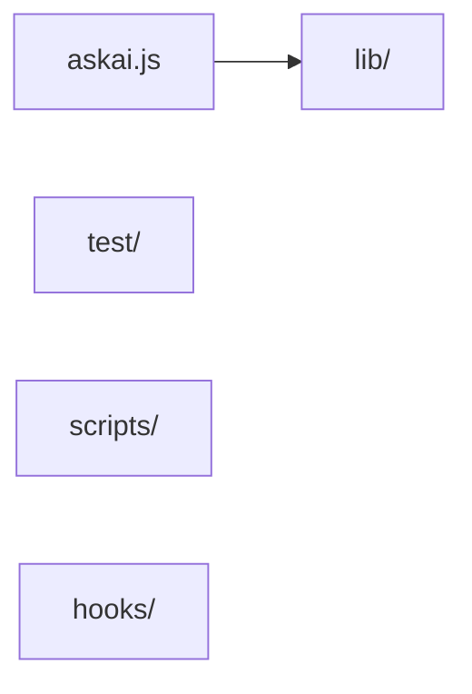

<!-- askai:generated by `askai init`; evidence from repository files. Review inferred structure. -->
# Architecture

Reviewed against README, manifests and 119 eligible first-party source files on 24 October 2026. Imports show static dependencies, not runtime behavior.

## Components
| Component | Evidence |
| --- | --- |
| Entry | `askai.js` (`package.json` bin `askai`) |
| `lib/` | Shared application modules |
| `test/` | Automated tests |
| `scripts/` | Maintenance scripts |
| `hooks/` | `askai-report.js` reads local transcripts for spend reports |

## Cross-folder imports
- `(root)/` → `lib/` (import in `askai.js`).
- `scripts/` → `lib/` (import in `scripts/gen-docs.js`).
- `test/` → `lib/` (import in `test/claude-config.test.js`).
- `test/` → `(root)/` (import in `test/cli.test.js`).

## Data flow
- Start at `askai.js` (`package.json` bin `askai`). There is no build script.
- `askai.js` loads modules from `lib/` (`require('./lib/...')` in `askai.js`).
- `lib/surface.js` defines the compact command surface and generates `docs/CHEAT_SHEET.md`; `scripts/build-cheatsheets.py` renders the two A3 cheat-sheet images and the one PDF from `lib/help.js`. `scripts/gen-docs.js --check` checks the generated Markdown.
- `lib/project-registry.js` resolves short project names to folders. `lib/project.js` and `lib/project-source.js` scan eligible source and manage the project knowledge pack; `.ai-work/` holds local review and handoff state.
- `lib/plugins-ready.js` recommends a source-only Graphify build for the first run; full document/image extraction is an explicit, model-using Graphify operation.
- Existing recorded profiles skip tool installation during `cli --prepare`; first setup and explicit refresh still configure tools. `lib/usage.js` separates uncached input from cached input and distinguishes raw totals from weekly plan usage. Installer runtime synchronization refreshes an existing managed legacy app without replacing its surrounding state files.
- Default `askai cli --prepare` selects a project and opens the terminal without source analysis. Explicit `--review` enables setup and changed-path review; the review marker is written only after that review.
- `lib/runtime.js` fingerprints installed code and stamps its revision. `lib/graph-query.js` bounds optional queries and reports graph freshness without rebuilding implicitly.
- MCP diagnostics separate configured, responding and client-attached states. `lib/mcp.js` reads bounded direct Codex call events and normalized exports; wrapper text and opaque Antigravity logs are not inferred. Reports distinguish account-wide logs from project exports.
- `lib/session.js` records quota plans and before/after observations; comparisons require matched account/window/task/model/effort/acceptance, successful outcomes and explicit isolation confirmation.
- `askai update` fetches the latest checkout into the AskAI installation and reapplies its recorded profile. With `--agents`, separate host sessions review the checkout before Codex applies verified changes.

## Critical invariants (must never break)
- AskAI never enters credentials. Sign-in stays in each tool. (README.md Safety)
- An unparseable `settings.json` or `~/.claude.json` stops the run. AskAI does not overwrite a file it could not read. (README.md Safety)
- `askai uninstall` removes only what AskAI added, as recorded in the manifest. (README.md Safety)

## Known problems and current focus
- Native Codex/Antigravity reconnection remains a human check. No valid baseline/AskAI trial has run, so net subscription savings remain unproven. Static indexing and graph freshness do not prove complete language semantics.

## Decisions
Add a row after a decision is made: date, decision, why.

| Date | Decision | Why |
| --- | --- | --- |

## Sensitive boundaries
- Never paste API keys, tokens, private keys or confidential data here.
