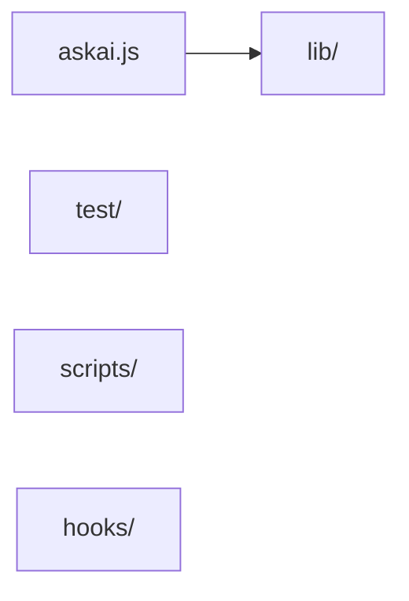

<!-- askai:generated by `askai init`; evidence from repository files. Review inferred structure. -->
# Architecture

Generated from README, manifests and 71 first-party source files. Imports show static dependencies, not runtime behavior. Review component responsibilities and add decisions as work proceeds.

## Components
| Component | Evidence |
| --- | --- |
| Entry | `askai.js` (`package.json` bin `askai`) |
| `lib/` | Shared application modules |
| `test/` | Automated tests |
| `scripts/` | Maintenance scripts |
| `hooks/` | 1 file, mostly .js |

## Cross-folder imports
- `(root)/` → `lib/` (import in `askai.js`).
- `scripts/` → `lib/` (import in `scripts/gen-docs.js`).
- `test/` → `lib/` (import in `test/claude-config.test.js`).
- `test/` → `(root)/` (import in `test/cli.test.js`).

## Data flow
- Start at `askai.js` (`package.json` bin `askai`). There is no build script.
- `askai.js` loads modules from `lib/` (`require('./lib/...')` in `askai.js`).

## Critical invariants (must never break)
- AskAI never enters credentials. Sign-in stays in each tool. (README.md Safety)
- An unparseable `settings.json` or `~/.claude.json` stops the run. AskAI does not overwrite a file it could not read. (README.md Safety)
- `askai uninstall` removes only what AskAI added, as recorded in the manifest. (README.md Safety)

## Known problems and current focus
- None confirmed by the scan. README.md ## Known risks lists vendor interactions that are still unverified.

## Decisions
Add a row after a decision is made: date, decision, why.

| Date | Decision | Why |
| --- | --- | --- |

## Sensitive boundaries
- Never paste API keys, tokens, private keys or confidential data here.
